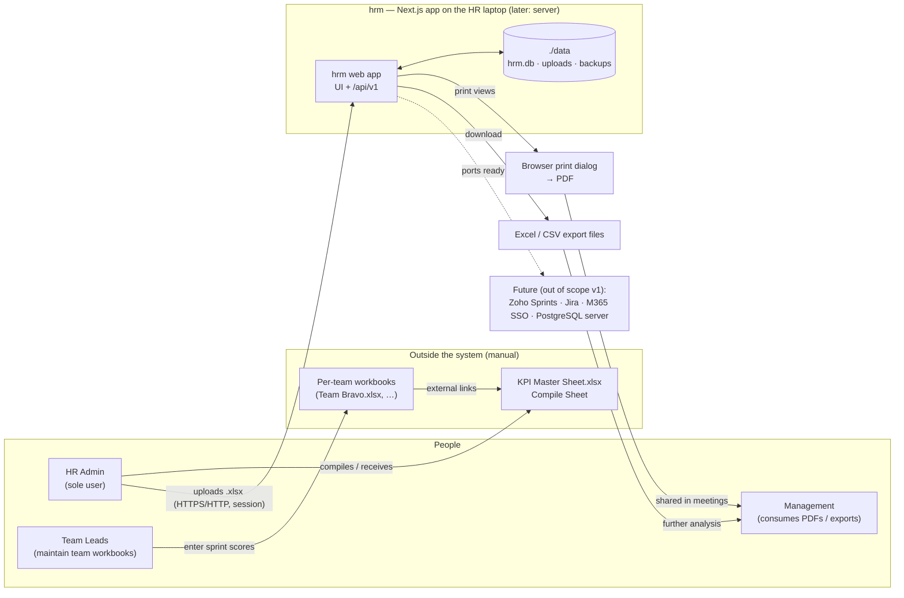
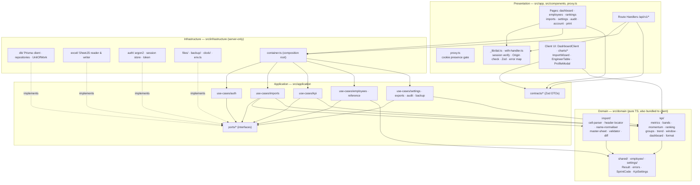
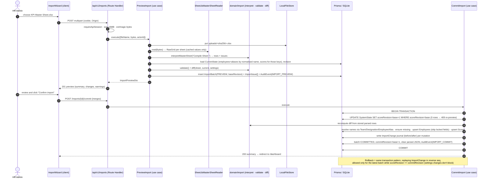
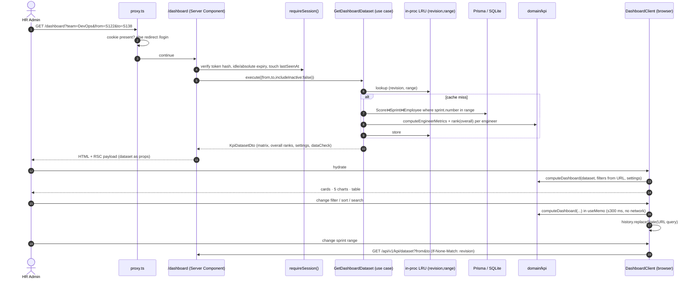
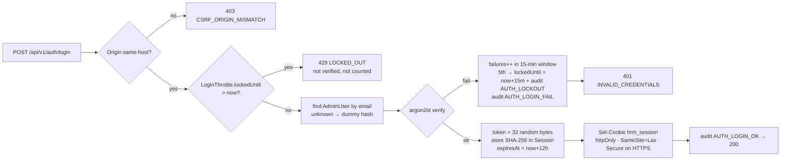
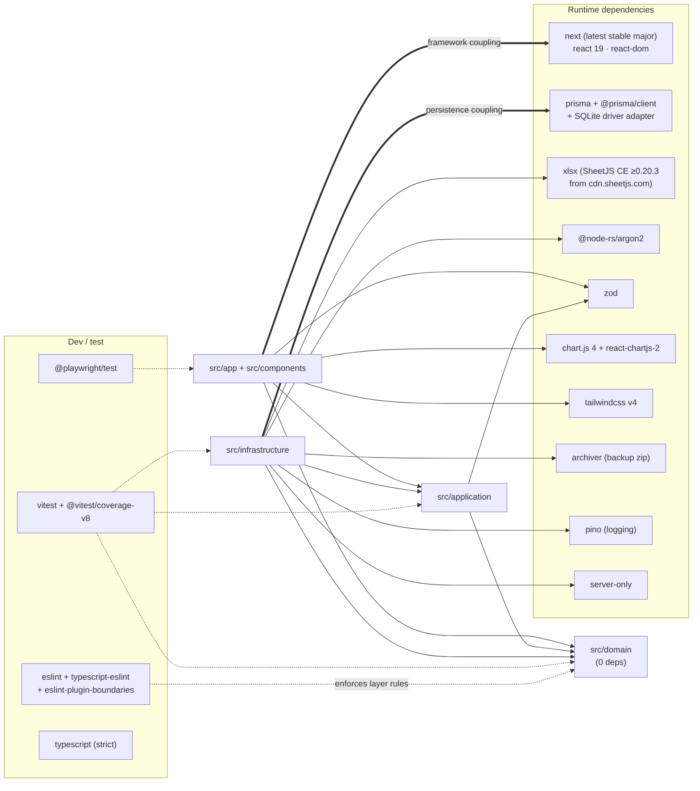

# Architecture Views — hrm

Companion to [architecture.md](architecture.md). Four AAID views: System Map, Module Map, Data Flow, Dependency Graph.

---

## 1. System Map

The system boundary, external actors and integrations. In v1 there are no live integrations; data enters only through file upload.

---

## 2. Module Map

Internal modules by Clean Architecture layer and their responsibilities. Arrows show allowed `import` direction.

| Module | Responsibility |
|---|---|
| `domain/kpi` | Every KPI formula: per-engineer metrics, bands, momentum, rankings, weighted group averages, sprint trend, last-N window, dashboard composition, number formatting |
| `domain/import` | Turn a raw cell grid into typed rows; detect the header; parse RUN/N/A; normalise names; validate; diff against current state |
| `application/use-cases/*` | Orchestrate one user intent each, using transactions, audit, ports and domain functions |
| `application/contracts` | Zod request/response schemas shared by server handlers and client fetchers |
| `infrastructure/db` | Prisma persistence, the matrix pivot query and transactions |
| `infrastructure/excel` | Safe SheetJS read (cached values, magic bytes) and write (injection escaping) |
| `infrastructure/auth` | argon2id hashing, DB sessions, token generation |
| `presentation` | Routing, auth gates, HTTP mapping, React UI, charts, print layouts |

---

## 3. Data Flow

### 3a. Import: upload → preview → commit (→ rollback)

### 3b. Dashboard: request → compute → render → filter

### 3c. Authentication

---

## 4. Dependency Graph

Libraries and services, and where coupling concentrates. Thick edges are high-coupling hotspots; dotted edges are dev/test only.

**Coupling hotspots and mitigations**

| Hotspot | Risk | Mitigation |
|---|---|---|
| `next` in presentation | Major-version churn (middleware → proxy rename, caching defaults) | Business logic kept out of presentation; thin route handlers via `withHandler` |
| `prisma` in infrastructure | Engine/adapter changes between majors; SQLite ↔ PostgreSQL differences | Repositories behind ports; integer score storage (ADR-004); no raw SQL except the backup provider |
| `xlsx` (SheetJS) | Security advisories on the npm 0.18.x line; distribution off the npm registry | CDN ≥0.20.3 pinned with integrity hash; single adapter behind `SpreadsheetReader`/`Writer` |
| `src/domain/kpi` | Central to every number (fan-in from client, use cases, exports) | Zero dependencies, 100% branch coverage, golden-fixture tests |
| `@node-rs/argon2` | Native binary per platform | Prebuilt for win32/linux/darwin; fallback to `bcryptjs` behind `PasswordHasher` if a target lacks a prebuild |
