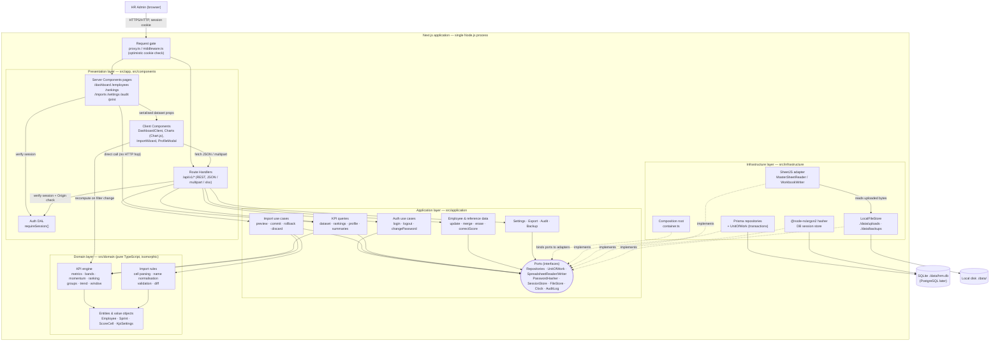
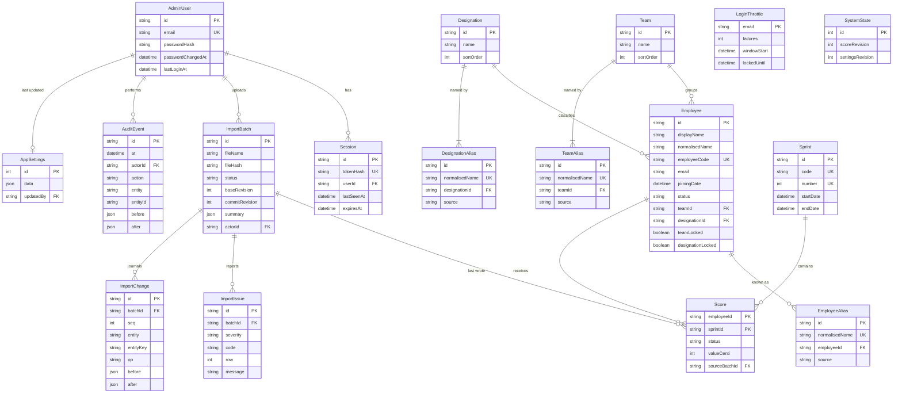

# Architecture — hrm (Cloudtech HRM & Engineering KPI Dashboard)

**Version:** 1.0 · **Date:** 2026-10-15 · **Pattern:** Clean Architecture · **Stack:** TypeScript, Next.js (App Router), Prisma, SQLite → PostgreSQL
**Inputs:** [requirements.md](../requirements/requirements.md) · `KPI Master Sheet (2).xlsx` · `Cloudtech_KPI_Dashboard_S122-S135.html`

## Context Summary

| Concern | Answer |
|---|---|
| Core journeys | HR Admin logs in → uploads the KPI Master Sheet → reviews the preview, changes and data-check warnings → commits (or rolls back) → explores the dashboard → opens the engineer profile and rankings → prints a PDF or exports to Excel for Management. |
| Scale | 1–3 concurrent HR users. Today about 50 engineers × 17 sprints; designed for 500 engineers × 200 sprints (≈100k score cells). |
| Integrations | None in v1. The only input is the uploaded `.xlsx`/`.csv` in the Compile Sheet layout. |
| Constraints | One Next.js TypeScript project holds UI and backend. Runs locally on Windows with Node 24. One developer, no hosting budget. Strict aaid quality gates: 80% test coverage, 0 lint errors, complexity ≤ 10. |
| Security | Single HR Admin role, hashed passwords, server-side sessions, lockout, safe upload parsing, CSV-injection-safe export, audit log, Nepal Individual Privacy Act 2075. |
| Performance-sensitive work | Parsing and diffing the Excel file (≤ 5 s), recomputing KPIs on every filter change (≤ 300 ms), printing. |
| Deployment | Local `npm run build && npm start`. Manual move to a server later; the app stays container-ready. No CI/CD in v1. |

---

## Architecture Diagram



---

## Architecture Decision Records (ADRs)

**ADR-001: Single Next.js App Router application for UI and backend**
- **Status**: Accepted
- **Context**: The user asked for the frontend and backend in one folder. There is one developer, no hosting budget, local-first use, and 1–3 users.
- **Decision**: One Next.js project using the App Router. Server Components render pages and call application use cases directly. Route Handlers under `/api/v1/*` serve client mutations, file upload/download and exports. Pin the **latest stable Next.js major at scaffold time** (16.x expected; 15.x acceptable) together with React 19 and Node 24 LTS. Rejected alternatives: a separate Express/NestJS API (two processes to deploy, duplicated types) and Server Actions for all mutations (multipart upload, file downloads and a testable REST contract are clearer as Route Handlers; Server Actions are allowed only for simple forms such as login and settings, if desired).
- **Consequences**: One deploy unit and shared TypeScript types end to end. The backend is tied to the Next.js runtime, but clean architecture (ADR-002) keeps business logic framework-free, so it can be extracted later. Long-running work is bounded (imports take under 5 s), so no job queue is needed.

**ADR-002: Clean Architecture with an isomorphic (shared client/server) domain layer**
- **Status**: Accepted
- **Context**: `aaid.config.yaml` mandates clean architecture. KPI rules must give identical numbers in the dashboard, rankings, exports and print (BO-2: 100% accuracy). Filters must recompute in ≤ 300 ms (NFR-02).
- **Decision**: Four layers (`domain` → `application` → `infrastructure` / `presentation`) with dependencies pointing inward only. `src/domain` is pure TypeScript with zero runtime dependencies (no Node APIs, no Prisma, no React), so the browser can import the same `kpi` module for instant recomputation while the server uses it for authoritative rankings and exports. Boundaries are enforced by `eslint-plugin-boundaries` (or `dependency-cruiser`) rules that fail lint.
- **Consequences**: One implementation of every formula, and it can be tested in isolation (100% branch coverage target). It requires discipline: no `Date.now()`, `crypto` or I/O in the domain; these are injected via ports. The extra mapping between Prisma models and domain types is accepted.

**ADR-003: SQLite via Prisma ORM now, PostgreSQL-ready**
- **Status**: Accepted
- **Context**: v1 runs locally, and the user will deploy it to a server later (OQ-10). It needs zero-setup storage, transactions for atomic imports (NFR-17) and painless migration (NFR-06).
- **Decision**: Prisma **≥ 6.2** (needed for `Json` and `enum` on SQLite; prefer the current major) with the SQLite provider, file `./data/hrm.db`, connected through the **current Prisma major's recommended SQLite driver adapter** (for example `@prisma/adapter-better-sqlite3` on Prisma 7). At scaffold time, verify that a prebuilt native binary exists for Node 24 on win32; the fallback is `@prisma/adapter-libsql` with a `file:` URL. Use only features both providers support: no raw SQL in repositories except the SQLite backup command, which is isolated behind `BackupProvider`. Enable WAL mode and `foreign_keys=ON` at startup. Migrations live in `prisma/migrations`. Rejected alternatives: Drizzle (fine, but Prisma's schema and migrations are simpler for a single developer, and the switch to PostgreSQL is a `provider` change plus a fresh baseline migration) and a JSON file store (no transactions or querying).
- **Consequences**: Zero-install database and easy backup (copy the file). SQLite has a single writer, which is fine for 1–3 users. Moving to PostgreSQL needs a new migration baseline and a data copy script (documented in the README). Decimal behaviour differs between providers, which ADR-004 avoids.

**ADR-004: Store scores as integer hundredths with an explicit cell status**
- **Status**: Accepted
- **Context**: Scores have 2 decimals (0.00–10.00). Cells can be RUN or N/A, which must never count as 0. Float storage causes drift (e.g. 8.33 + 8.67), and Decimal support differs between SQLite and PostgreSQL.
- **Decision**: The `Score` row stores `status ∈ {SCORED, RUN, NOT_SCORED}` and `valueCenti: Int?` (0–1000; required only when SCORED). The domain converts to `number` at the edge, computes totals in integer hundredths and averages as floats, and rounds only for display (2 dp). Missing rows mean the employee was not part of that sprint.
- **Consequences**: Exact, portable arithmetic and a lossless round-trip with the sheet for 2-dp values. Values with more than 2 dp are rounded half-up on import with a warning (see ADR-016; the sample file has one such cell, `E44 = 5.975`). The UI and exports must always go through the domain formatters. A check constraint (validated in the application and covered by tests) enforces that `valueCenti` is present exactly when the status is SCORED.

**ADR-005: Custom database-backed session authentication (no Auth.js, no JWT)**
- **Status**: Accepted
- **Context**: Single HR Admin role, email and password, lockout, idle and absolute expiry, server-side invalidation on logout and password change (US-01-01…04).
- **Decision**: Passwords are hashed with **argon2id via `@node-rs/argon2`** (prebuilt binaries, no node-gyp on Windows). Login issues a 256-bit random token in an `hrm_session` cookie (httpOnly, SameSite=Lax, Secure when served over HTTPS, Path=/, **Max-Age = absolute lifetime, 12 h**). Only the token's SHA-256 hash is stored in the `Session` table, with `lastSeenAt` and `expiresAt`.
  - **Idle expiry is enforced only on the server.** The timeout is 60 min. `lastSeenAt` is written at most every 5 min, so the effective idle timeout is 60–65 min, which is accepted.
  - **The DAL never writes cookies**, because Server Components cannot. On expiry it deletes the Session row and redirects; `/login` clears any stale cookie.
  - **Lockout** uses a `LoginThrottle{email, failures, windowStart, lockedUntil}` row per normalised email. The 5th failure within a 15-min window sets `lockedUntil = now + 15 min`. While locked, attempts return 429 without checking the password or adding to the count. The same logic applies to unknown emails, and an unknown email is still verified against a fixed dummy argon2 hash so response timing doesn't reveal which accounts exist. A successful login resets the row.

  Rejected alternatives: Auth.js (its credentials provider discourages database sessions and adds complexity for one role) and stateless JWT (it can't be revoked on logout or password change without a denylist).
- **Consequences**: Small, auditable, fully tested auth code that we own. Rate limiting is per email; per-IP limiting is deferred because the app runs locally. A seed script creates the first admin from `ADMIN_EMAIL`/`ADMIN_PASSWORD` (US-01-03).

**ADR-006: Two-gate authorization — optimistic request gate plus a verifying Data Access Layer**
- **Status**: Accepted
- **Context**: NFR-08 requires server-side enforcement on every page and API. The Next.js request gate (`middleware.ts`, renamed `proxy.ts` in Next 16) should stay cheap, and following Next.js guidance it must not be the only check.
- **Decision**: Gate 1 (`proxy.ts`/`middleware.ts`) redirects to `/login`, or returns 401 for `/api/*`, when the session cookie is **absent**. It also generates the per-request CSP nonce (see Cross-cutting). Gate 2 is `requireSession()` in `src/app/_lib/dal.ts` (marked `server-only`, wrapped in `React.cache`). It validates the token hash, expiry and idle time in the database, and **every** Server Component page, layout and Route Handler calls it. Mutating Route Handlers (non-GET) also check that the `Origin` header matches the request host, or one of `TRUSTED_ORIGINS` when that env var is set (needed behind a reverse proxy later). This is CSRF defence on top of SameSite=Lax. Unauthenticated exceptions: `/login`, `POST /api/v1/auth/login`, `GET /api/health`, static assets.
- **Consequences**: Defence in depth. A forgotten `requireSession()` is caught by an integration test that crawls every route without a cookie and expects a 401 or redirect. Requests cost one indexed database lookup, which is negligible.

**ADR-007: Two-phase import (preview → commit) with a change journal for rollback and optimistic concurrency**
- **Status**: Accepted
- **Context**: HR must see exactly what will change before it is written (US-02-03), imports must be atomic (NFR-17), the latest import must be reversible (US-02-06), and sprints missing from the file must be preserved (US-02-05).
- **Decision**:
  1. **Preview.** `POST /api/v1/imports` stores the original file (content-addressed by SHA-256), parses it into a normalised `ParsedMasterSheet`, computes the diff against the current database, and saves an `ImportBatch{status: PREVIEW, baseRevision = scoreRevision, parsedJson, summaryJson}` together with its `ImportIssue` rows. Nothing else is written.
  2. **Commit.** `POST /imports/{id}/commit` runs in one transaction.
     - **Revision guard first.** The first statement is a conditional increment, `UPDATE SystemState SET scoreRevision = base + 1 WHERE id = 1 AND scoreRevision = base`. If it affects 0 rows, the transaction returns **409** and HR must re-preview. Doing this as the first statement takes SQLite's write lock up front, so concurrent commits can't both pass the check.
     - **Recompute the diff.** The diff is recomputed from the stored `parsed` rows inside the transaction (it equals the preview, because the revision is unchanged).
     - **Apply.** It upserts reference data (resolving names through aliases), employees, aliases and scores. Locked employee fields are never overwritten (ADR-018). Each mutation also writes an `ImportChange{entity, entityKey, before, after}` journal row.
     - **Finish.** It marks the batch COMMITTED with `commitRevision = base + 1`.
  3. **Rollback.** Only the most recent COMMITTED batch can be rolled back, and only when `scoreRevision === commitRevision`, so later score or employee edits, merges and erasures block it. Settings changes do **not** block it: they bump the separate `settingsRevision`. Rollback replays the journal in reverse inside one transaction, guarded by the same conditional increment.
  4. Previews expire after 30 minutes; a lazy cleanup runs on the next upload.
- **Consequences**: Imports are safe, auditable and reversible, and the "is this file different from last time?" question is answered by the file hash. The journal grows with every import (about 1k rows per import, which is negligible). Rolling back older batches is deliberately not supported.

**ADR-008: SheetJS (CDN distribution) for spreadsheet parsing and writing, cached values only**
- **Status**: Accepted
- **Context**: The master sheet uses formulas and external workbook links (`'[1]Team Bravo'!C6`). We need the cached values, header detection and `.xlsx` export. The npm-registry package `xlsx@0.18.5` has known vulnerabilities (prototype pollution CVE-2023-30533, ReDoS CVE-2024-22363), which would fail NFR-14.
- **Decision**: Use **SheetJS Community Edition ≥ 0.20.3 installed from `https://cdn.sheetjs.com/`** (tarball URL in `package.json`), wrapped behind the `SpreadsheetReader`/`SpreadsheetWriter` ports. Read with `{cellFormula: false, cellHTML: false, sheetStubs: false, dense: true}` and never evaluate formulas. Use raw numeric values (`cell.v`), not formatted text.

  **Upload hardening:**
  1. Reject when `Content-Length > UPLOAD_MAX_BYTES` before reading the body, and count bytes while streaming (Route Handlers have no built-in limit).
  2. Validate the file signature: the ZIP magic bytes `PK\x03\x04` for `.xlsx`, or UTF-8 text for `.csv`. Reject `.xlsm` and encrypted files (CFB magic bytes `D0 CF 11 E0`).
  3. **Zip-bomb guard:** before SheetJS parses the file, read the ZIP central directory and reject if the total uncompressed size exceeds 50 MB or there are more than 200 entries. Rejected alternative: ExcelJS (heavier and slower on read, and it adds no value for this layout).
- **Consequences**: One library for reading and writing, and it is fast (a 5 MB workbook parses in under 1 s). The CDN-hosted dependency must be pinned with an integrity hash in the lockfile. Because the library sits behind a port, it can be swapped if licensing or security changes.

**ADR-009: Server-authoritative dataset plus client-side recomputation for filters**
- **Status**: Accepted
- **Context**: Filter, sort and search changes must update cards, five charts and the table in ≤ 300 ms (NFR-02). The data is small (≤ 100k cells), and the overall rank must not change when the UI is filtered.
- **Decision**: The dashboard page (a Server Component) calls `GetDashboardDataset(range)`, which returns sprints, employees, the score matrix, settings, server-computed **overall ranks** and the data-check summary. This is passed as props to `DashboardClient`, which runs `computeDashboard(dataset, filters, settings)` from the shared domain in a `useMemo`. Changing the sprint range re-fetches from `/api/v1/kpi/dataset` (ETag = `scoreRevision.settingsRevision` + range). Rankings, profiles, exports and print views are computed **on the server** with the same functions. Cells are encoded compactly as `(number | 'R' | null)[]`: the score, `'R'` for RUN, or null for not scored.
- **Consequences**: Filtering is instant with no extra round trips, and the numbers are identical everywhere because there is one implementation. The payload is about 15 KB for 50 × 20 cells and about 0.6 MB uncompressed at the 500 × 200 ceiling (gzip about 120 KB). When the dataset exceeds 1 MB, the page renders the shell and the client fetches the dataset, so the RSC payload isn't duplicated in the HTML. If the scale target is exceeded, filtering moves to the server without changing the domain.

**ADR-010: Chart.js and Tailwind CSS with design tokens from the reference report**
- **Status**: Accepted
- **Context**: Management already knows the look of `Cloudtech_KPI_Dashboard_S122-S135.html` (NFR-26). Accessibility rules: never convey meaning by colour alone, provide table alternatives (NFR-24).
- **Decision**: Use `chart.js` 4.x with `react-chartjs-2`, registering only the controllers we use (tree-shaken). Tailwind CSS v4 with CSS variables `--navy #10233F`, `--teal #0F6E78`, `--teal2 #13909c`, `--green #1E8E4E`, `--amber #C8881A`, `--red #C0392B`. Charts load client-side only (`dynamic(..., {ssr:false})`). Each chart has a visually hidden `<table>` alternative and an `aria-describedby` summary. Rejected alternatives: Recharts (a different look from the reference) and ECharts (heavier).
- **Consequences**: Visual continuity, and a small bundle (Chart.js is about 70 KB gzipped when tree-shaken). Canvas charts print correctly at the `beforeprint` resize.

**ADR-011: REST Route Handlers under `/api/v1` with Zod contracts and a uniform error envelope**
- **Status**: Accepted
- **Context**: Client mutations, file transfer and future integrations or tests need a stable, validated contract (NFR-11).
- **Decision**: Every handler is a thin adapter: `requireSession()` → Zod-parse params/body → call the use case → map the `Result` to HTTP. Shared Zod schemas live in `src/application/contracts/*` and are imported by both client and server. Errors use `{ error: { code: string; message: string; details?: unknown } }` with stable codes (`UNAUTHENTICATED`, `VALIDATION_FAILED`, `NOT_FOUND`, `CONFLICT_STALE_PREVIEW`, `IMPORT_INVALID_FILE`, `LOCKED_OUT`, …). Use cases return `Result<T, DomainError>`; only infrastructure faults throw, and those map to 500 with a correlation ID that is logged.
- **Consequences**: A predictable API that is easy to test with integration tests. There is a small amount of handler boilerplate, kept down by a `withHandler()` wrapper.

**ADR-012: Browser print CSS for PDF instead of server-side headless rendering**
- **Status**: Accepted
- **Context**: US-07-01/03 need PDFs of the dashboard and of each engineer. Running locally on Windows, a headless Chromium (Puppeteer) adds about 150 MB and makes deployment fragile.
- **Decision**: Dedicated print routes `/print/dashboard?…` and `/print/employees/[id]` (plus `/print/teams/[id]` for a batch print) with `@media print` CSS: A4, `break-inside: avoid`, a header showing filters, range and timestamp, and a "Cloudtech Services · Confidential" footer. The user saves as PDF through the browser's print dialog. Charts are drawn with `animation:false` and a fixed `devicePixelRatio: 2` for crisp output.
- **Consequences**: No extra dependencies, and the output is the same as on screen. PDF creation is manual (the print dialog), and automated or emailed PDFs are deferred. Server-side rendering can be added later as a `PdfRenderer` port.

**ADR-013: Local filesystem storage under `./data` behind ports**
- **Status**: Accepted
- **Context**: Uploaded originals must be kept for audit, rollback evidence and backup (US-09-02), outside the web root (NFR-10).
- **Decision**: `DATA_DIR` (default `./data`, git-ignored) contains `hrm.db`, `uploads/<sha256>.<ext>` and `backups/`. Access goes through the `FileStore` port (`LocalFileStore`). Backup uses `BackupProvider` (`SqliteBackupProvider`: `VACUUM INTO` a temporary file, then zip it with the uploads using `archiver`, streamed to the response).
- **Consequences**: Simple and portable; the whole state lives in one folder. On a future server, `DATA_DIR` must be a persistent volume. A PostgreSQL backup provider (`pg_dump`) is a later task.

**ADR-014: Quality gates — Vitest, Playwright and fixture-driven golden tests**
- **Status**: Accepted
- **Context**: The aaid gates require ≥ 80% coverage, unit and integration tests, 0 lint errors and complexity ≤ 10. BO-2 requires proof of 100% calculation accuracy.
- **Decision**: **Vitest** for domain unit tests (100% branch coverage on `src/domain`), and for application and integration tests against a temporary SQLite database per test file (`prisma migrate reset` into a temp `DATA_DIR`). **Golden tests** (all asserted to ±0.01):
  - `tests/fixtures/kpi-master-sheet.xlsx` (a copy of the sample): per-engineer totals and averages, **overall ranks taken from the Compile Sheet "Overall Rankings" block**, last-N averages from Sheet1, and the Performance Insights team, designation and trend figures.
  - `tests/fixtures/reference-s122-s135.json` (from the HTML `RAW`): **only** total, average, last-3, prior-3, momentum, best/worst, spread and band. Its `rank` field is **not** asserted, because those ranks were copied from an older sheet and don't follow the averages (e.g. Jeevan Joshi 9.07 → rank 42). This is recorded as a known difference.

  **Performance tests:**
  - Vitest `bench` and threshold tests: `computeDashboard` on a synthetic 500 × 200 dataset ≤ 100 ms.
  - Parse and diff of a generated 200-row, about 5 MB workbook ≤ 5 s.
  - Playwright: filter change to repaint ≤ 300 ms.

  **Playwright** also covers e2e: login → import → dashboard → profile → export. ESLint uses `complexity: ["error", 10]` and boundary rules. `npm run verify` runs typecheck, lint, test and build.
- **Consequences**: High confidence in the numbers Management relies on, and no test that tries to reproduce a broken legacy ranking. Golden files must be updated deliberately whenever business rules change, and that update is reviewed.

**ADR-015: Configuration and policy via a validated settings singleton**
- **Status**: Accepted
- **Context**: Rating bands, the last-N window, eligibility thresholds and the import overwrite policy are business policy, and several are still open (OQ-04…07).
- **Decision**: An `AppSettings` singleton row (`id = 1`) with a JSON column validated by the Zod `KpiSettingsSchema` and default values in `src/domain/settings/defaults.ts`. Settings changes increment `settingsRevision` (not `scoreRevision`), so caches and ETags become invalid without blocking import rollback. Open questions become settings, with these defaults:

  | Setting | Default | Rationale / source |
  |---|---|---|
  | `bands` | Outstanding ≥ 8.00 · Exceeds ≥ 6.00 · Meets ≥ 5.00 · Needs Improvement < 5.00 | US-04-02; compared on the 2-dp average (ADR-016) |
  | `rankingScope` | `overall` | The dashboard Rank column always shows the overall rank; the designation rank is on the profile and the Rankings tab (OQ-04) |
  | `rankEligibilityMinSprints` | 1 | Matches the current sheet (OQ-05 may raise it) |
  | `topN` / `topNMinSprints` | 10 / 5 | Performance Insights F5 |
  | `lastNWindow` / `lastNMinSprints` | 6 / 1 | Sheet1 G1; the sheet ranks everyone in the window |
  | `momentumMinSprints` | 6 | US-04-01 AC-3 |
  | `dataCheckTolerance` / `totalCheckTolerance` | 0.02 / 0.05 | US-02-04 |
  | `importNotScoredOverwrites` | `true` | The file is the source of truth; N/A in a new file clears an old score (OQ-07) |
  | `uploadRetentionDays` | 90 | ADR-017 (OQ-11) |
- **Consequences**: Answering the open questions needs no code change. Every setting needs validation and tests, which keeps the settings list deliberately small.

**ADR-016: Numeric precision, rounding and comparison rules**
- **Status**: Accepted
- **Context**: Review findings #1 and #11. The sheet ranks on exact averages (Mandip at 9.00 is ranked above Sajjan, who shows 9.00 but is actually 8.9956). The reference HTML assigns bands on the 2-dp average. One sample cell has 3 dp (`5.975`). Naive float rounding is wrong for 68 of the 1,000 possible 3-dp half values (e.g. `1.005 × 100 = 100.4999…`). *Corrected 2026-10-15:* `5.975` itself rounds correctly to 598.
- **Decision**:
  1. **Ingest**: `centi = Math.round(v * 100 + 1e-7)` (half-up). If `|v*100 − round(v*100)| > 1e-9`, emit a `PRECISION_ROUNDED` warning naming the cell.
  2. **Totals** are integer sums of centi values.
  3. **Ranking** compares exact averages as integer cross-products, `totalCentiA × nB` vs `totalCentiB × nA`, with no floats. **Rank numbers** are competition ranks on the exact average alone, so equal exact averages share a rank (1, 2, 2, 4) even when totals differ. *Amended 2026-10-15 from workbook evidence:* in the last-6 ranking, Sajjan (49.00/5) and Ashika (9.80/1) both hold rank 2. **Display order** within a tie is `totalCenti` desc, then name.
  4. **Bands** use the average rounded half-up to 2 dp (`Math.round(totalCenti / n + 1e-9) / 100`), which is exactly the value users see.
  5. **Display**: always 2 dp. When two adjacent rows display the same average but have different ranks, the tooltip shows 3 dp.
  6. **Momentum, last-3 and spread** are computed on the exact values and rounded to 2 dp for display only.
- **Consequences**: Rankings match the sheet exactly, and the rating always agrees with the number shown. The golden tests cover both boundary cases (7.995 → Outstanding; 9.00 vs 8.9956 ordering).

**ADR-017: Personal-data erasure and upload retention**
- **Status**: Accepted
- **Context**: NFR-15 (Nepal Individual Privacy Act 2075) and review finding #4. The original uploads, the import journal, issues and the audit trail all contain names and scores, and a rollback could resurrect an erased person.
- **Decision**: `EraseEmployee` runs in one transaction and does the following:
  1. Deletes the employee, their scores and aliases.
  2. Redacts `ImportChange.before/after`, `ImportIssue.employeeName/message` and `AuditEvent.before/after/meta` that reference the employee's ID or any of their normalised names, replacing those values with `"[erased]"`.
  3. Bumps `scoreRevision`, which makes every earlier batch non-rollback-able.
  4. Deletes all stored upload originals (they contain the person). The confirmation dialog lists how many files will be removed.
  5. Writes a single `EMPLOYEE_ERASE` audit event containing only the former employee ID.

  Separately, uploads older than `uploadRetentionDays` (default 90) are purged lazily on the next upload, and their batches keep only summary metadata.
- **Consequences**: Erasure is real and testable (an integration test searches every table and the uploads folder for the erased name). The cost is that original files used for older batches can no longer be downloaded after an erasure or the retention period.

**ADR-018: Alias-based identity for employees, teams and designations; HR-locked fields**
- **Status**: Accepted
- **Context**: Review findings #3 and #13. Team names drift between sheets (`Run Team` / `RUN`, `Team Bimal` / `Bimal`). HR will rename labels and correct employees' teams, but a naïve import would recreate old teams and overwrite those corrections. Employee name uniqueness was split across two tables.
- **Decision**:
  - `EmployeeAlias`, `TeamAlias` and `DesignationAlias` are the **only** unique name namespaces. Each canonical name is itself an alias row with `source = CANONICAL`. Renaming adds the new canonical alias and keeps the old one as `source = RENAME`, and imports resolve every name through the alias tables.
  - When HR edits an employee's team or designation, `Employee.teamLocked` or `designationLocked` is set to true. Imports never overwrite a locked field; the preview raises a `LOCKED_FIELD_DIFFERS` warning showing the file's value, and HR can unlock the field from the employee editor.
  - When one normalised name in a file maps to more than one employee, the import fails with `AMBIGUOUS_NAME` until the sheet carries an `Employee Code` column. Header detection recognises an optional `Code` / `Employee Code` column, and when it is present, matching uses the code first (OQ-01).
- **Consequences**: Renames survive re-imports, and HR corrections are never silently lost. There is one more table per label type, and the preview gets slightly richer.

---

## Design Pattern Application Guide — Clean Architecture

**Intent in this project.** Keep the KPI rules, which are the business's source of truth for appraisals, independent of Next.js, Prisma, SheetJS and Chart.js. Then the rules can be verified exactly against the spreadsheet and the reference report, reused unchanged in the browser, and outlive changes of framework or database (SQLite → PostgreSQL, Next 15 → 16).

**Where it applies**

| Layer | Folder | Contains | May import |
|---|---|---|---|
| Domain | `src/domain/**` | `kpi/` (metrics, bands, momentum, ranking, groups, trend, window, dashboard), `import/` (cell parsing, header detection rules, name normalisation, validation, diff), `employee/`, `settings/` (defaults and schema types), `shared/` (Result, errors, SprintCode) | nothing outside `src/domain` (no `zod` either: plain types plus hand-written guards) |
| Application | `src/application/**` | `use-cases/<area>/<VerbNoun>.ts`, `ports/*.ts`, `contracts/*.ts` (Zod DTO schemas), `dto/` mappers | `src/domain`, `zod` |
| Infrastructure | `src/infrastructure/**` | `db/` (Prisma client and repositories), `excel/` (SheetJS adapters), `auth/` (Argon2 hasher, session store), `files/`, `backup/`, `clock/`, `container.ts` | `src/domain`, `src/application`, third-party SDKs; marked `import 'server-only'` |
| Presentation | `src/app/**`, `src/components/**`, `proxy.ts` | Pages, layouts, Route Handlers, DAL, client components, charts, print layouts | `src/application` (use cases via the container, contracts), `src/domain` (types, `computeDashboard`, formatters); **never** `src/infrastructure` except `container.ts` from server code |

**Folder structure**
```
hrm/
├─ prisma/  schema.prisma · migrations/ · seed.ts
├─ data/                       # git-ignored: hrm.db, uploads/, backups/
├─ src/
│  ├─ domain/
│  │  ├─ shared/               result.ts · errors.ts · sprint-code.ts
│  │  ├─ kpi/                  score-cell.ts · metrics.ts · bands.ts · momentum.ts · ranking.ts
│  │  │                        groups.ts · trend.ts · window.ts · dashboard.ts · format.ts
│  │  ├─ import/               cell-parser.ts · header-locator.ts · name-normaliser.ts
│  │  │                        master-sheet.ts · validator.ts · diff.ts
│  │  ├─ employee/             employee.ts
│  │  └─ settings/             kpi-settings.ts · defaults.ts
│  ├─ application/
│  │  ├─ ports/                repositories.ts · unit-of-work.ts · spreadsheet.ts · security.ts
│  │  │                        file-store.ts · clock.ts · audit-log.ts · backup.ts
│  │  ├─ contracts/            auth.ts · imports.ts · kpi.ts · employees.ts · settings.ts · common.ts
│  │  └─ use-cases/            auth/ · imports/ · kpi/ · employees/ · reference/ · settings/
│  │                           exports/ · audit/ · backup/
│  ├─ infrastructure/
│  │  ├─ db/                   prisma.ts · mappers.ts · repositories/*.ts · prisma-unit-of-work.ts
│  │  ├─ excel/                sheetjs-master-sheet-reader.ts · sheetjs-workbook-writer.ts
│  │  ├─ auth/                 argon2-password-hasher.ts · prisma-session-store.ts · token.ts
│  │  ├─ files/                local-file-store.ts
│  │  ├─ backup/               sqlite-backup-provider.ts
│  │  ├─ clock/                system-clock.ts
│  │  └─ container.ts          # composition root
│  ├─ app/
│  │  ├─ (auth)/login/page.tsx
│  │  ├─ (app)/layout.tsx      # calls requireSession()
│  │  ├─ (app)/dashboard/ · employees/[id]/ · rankings/ · imports/[id]/ · settings/ · audit/ · account/
│  │  ├─ print/dashboard/ · print/employees/[id]/ · print/teams/[id]/
│  │  ├─ api/v1/…              # Route Handlers (see API contract)
│  │  ├─ api/health/route.ts
│  │  └─ _lib/                 dal.ts · with-handler.ts · http-errors.ts · origin-check.ts
│  ├─ components/              ui/ · charts/ · dashboard/ · import/ · employees/ · print/
│  └─ proxy.ts                 # or middleware.ts on Next 15
└─ tests/  unit/ · integration/ · e2e/ · fixtures/
```

**How to apply it**
- **Ports are interfaces in `application/ports`**, named after the capability (`EmployeeRepository`, `SpreadsheetReader`). Adapters are named `<Tech><Port>` (`PrismaEmployeeRepository`, `SheetJsMasterSheetReader`).
- **One use case is one class or function** with a single `execute(input): Promise<Result<Output, AppError>>`. Its dependencies come through the constructor or a factory (`makeCommitImport(deps)`). No use case imports Prisma or Next.
- **The composition root** `infrastructure/container.ts` builds singletons lazily (`getContainer()`), cached on `globalThis` in development to survive hot reloads. Route Handlers and pages call `getContainer().useCases.commitImport.execute(...)`.
- **The domain is pure functions over plain data**: `computeEngineerMetrics(cells, settings)`. Domain functions take `now` or IDs as parameters, never generate them.
- **Transactions** go through `UnitOfWork.run(async (tx) => …)`, which hands the use case transaction-bound repositories. Prisma's `$transaction` appears only in `PrismaUnitOfWork`.
- **DTO mapping**: Prisma model → domain entity in `infrastructure/db/mappers.ts`; domain → response DTO in `application/dto`. Prisma types never reach presentation.
- **Validation**: Zod at the presentation/application edge (request shape). The domain validator handles business rules (score range, duplicate names).
- **Naming**: files in kebab-case, types in PascalCase, use cases as VerbNoun (`PreviewImport`, `GetEngineerProfile`), errors as `DomainError` subclasses with a `code`.

**Anti-patterns to avoid (TypeScript / Next.js specific)**
- Importing `@/infrastructure/db/prisma` (or `@prisma/client` types) in a page, component or use case. Use the container and DTOs.
- Putting KPI math in React components, `useMemo` bodies or SQL. Call `src/domain/kpi`.
- Domain files importing `zod`, `date-fns-tz`, `node:crypto` or `next/*`. This breaks client bundling and purity.
- Anemic "service" god classes (`KpiService` with 30 methods). Split by use case.
- Relying on `proxy.ts`/`middleware.ts` alone for auth, or reading cookies in client components.
- Passing Prisma `Decimal`/`Date` objects across the RSC boundary. Pass serialisable DTOs (ISO strings, numbers).
- `any`, or non-null `!` assertions, to silence the type checker at port boundaries. Use proper discriminated unions (`ScoreCell`).
- Generic repositories (`Repository<T>`) leaking query-builder semantics. Expose intent-revealing methods (`findByNormalisedNames`).

---

## Component Breakdown

### Domain layer

**ScoreCell & SprintCode (value objects)**
- **Responsibility**: Represent one sprint cell (scored, run or none) and validate and order sprint codes.
- **Inputs / Outputs / Dependencies**: raw values → typed values; no dependencies.
```ts
type SprintCode = `S${number}`;
type ScoreCell = { kind: 'scored'; centi: number } | { kind: 'run' } | { kind: 'none' };
function parseSprintCode(s: string): SprintCode | null;
function compareSprintCodes(a: SprintCode, b: SprintCode): number;      // numeric order
function toScore(cell: ScoreCell): number | null;                         // centi/100
```

**EngineerMetricsCalculator** (`kpi/metrics.ts`, `kpi/momentum.ts`)
- **Responsibility**: Compute one engineer's stats over an ordered list of cells.
- **Inputs**: `ScoreCell[]` aligned to the sprints in range, `KpiSettings`. **Outputs**: `EngineerMetrics`.
```ts
interface EngineerMetrics {
  sprintsCounted: number; runSprints: number; total: number | null; average: number | null;
  last3: number | null; prior3: number | null; momentum: number | null;
  best: number | null; worst: number | null; spread: number | null; band: BandKey;
}
function computeEngineerMetrics(cells: readonly ScoreCell[], s: KpiSettings): EngineerMetrics;
```

**RatingBandPolicy** (`kpi/bands.ts`)
- **Responsibility**: Map an average to a rating band using configurable thresholds.
```ts
type BandKey = 'out' | 'exc' | 'meet' | 'ni' | 'na';
interface BandDef { key: Exclude<BandKey,'na'>; label: string; min: number }   // descending by min
function bandFor(avg: number | null, bands: readonly BandDef[]): BandKey;
function validateBands(bands: readonly BandDef[]): Result<void, DomainError>;
```

**RankingService** (`kpi/ranking.ts`, `kpi/window.ts`)
- **Responsibility**: Produce competition rankings (overall, per designation, last-N) with eligibility rules.
```ts
interface Rankable { employeeId: string; name: string; designation: string; average: number | null; total: number | null; sprintsCounted: number }
interface RankedRow extends Rankable { rank: number | null; eligible: boolean }
function rank(rows: readonly Rankable[], opts: { minSprints: number; groupBy?: 'designation' }): RankedRow[];
function lastNWindow(sprints: readonly SprintCode[], hasData: (s: SprintCode) => boolean, n: number): SprintCode[];
```

**GroupAggregator & SprintTrend** (`kpi/groups.ts`, `kpi/trend.ts`)
- **Responsibility**: Weighted team and designation summaries, and per-sprint org averages with participants and coverage.
```ts
interface GroupSummary { key: string; people: number; scoreObs: number; totalScore: number; weightedAvg: number | null; rank: number | null }
function aggregate(rows: readonly EngineerSeries[], key: 'team' | 'designation'): GroupSummary[];
interface SprintPoint { sprint: SprintCode; average: number | null; participants: number; coverage: number }
function sprintTrend(sprints: readonly SprintCode[], rows: readonly EngineerSeries[], activeCount: number): SprintPoint[];
```

**DashboardComposer** (`kpi/dashboard.ts`)
- **Responsibility**: Turn a dataset plus filters into every view model the dashboard needs. This is the one function the client calls.
```ts
interface DashboardFilters { designation?: string; team?: string; band?: BandKey; coverage?: 'all'|'10'|'6'|'new'; q?: string; includeInactive?: boolean }
interface DashboardView {
  cards: KpiCard[]; byDesignation: GroupSummary[]; byTeam: GroupSummary[];
  distribution: Record<Exclude<BandKey,'na'>, number>; trend: SprintPoint[];
  movers: { employeeId: string; name: string; momentum: number; prior3: number; last3: number }[];
  table: EngineerRow[];   // includes server-supplied overall rank
}
function computeDashboard(ds: KpiDataset, f: DashboardFilters, s: KpiSettings): DashboardView;
```

**MasterSheetInterpreter** (`import/header-locator.ts`, `cell-parser.ts`, `master-sheet.ts`)
- **Responsibility**: Turn a raw 2-D grid of cell values (from any reader) into a `ParsedMasterSheet` with row-level issues.
- **Inputs**: `RawGrid = (string | number | null)[][]`, sheet name. **Outputs**: `ParsedMasterSheet`, `ImportIssue[]`.
```ts
interface ParsedRow { rowNumber: number; rawName: string; name: string; normalisedName: string; team: string; designation: string;
  cells: Record<SprintCode, ScoreCell>; sheetTotal: number | null; sheetAverage: number | null }
interface ParsedMasterSheet { sheetName: string; headerRow: number; sprints: SprintCode[]; rows: ParsedRow[] }
function locateHeader(grid: RawGrid, maxScan = 10): Result<HeaderMap, DomainError>;
function parseCell(v: unknown): ScoreCell | { kind: 'invalid'; raw: string };    // RUN / N/A / NA / - / blank / #ERR
function interpretMasterSheet(grid: RawGrid, sheetName: string): { sheet: ParsedMasterSheet; issues: ImportIssueDraft[] };
```

**NameNormaliser** (`import/name-normaliser.ts`)
- **Responsibility**: Canonicalise names for matching and flag likely duplicates.
```ts
function normaliseName(raw: string): string;              // NFC, trim, collapse whitespace, lower-case
function displayName(raw: string): string;                // trim + collapse whitespace, keep case
function nearDuplicates(a: string[], b: string[], maxDistance = 2): [string, string][];
```

**ImportValidator & ImportDiffEngine** (`import/validator.ts`, `import/diff.ts`)
- **Responsibility**: Check business rules (range, duplicates, sheet average/total mismatches) and compute the change set against current state.
```ts
function validate(sheet: ParsedMasterSheet, s: KpiSettings): ImportIssueDraft[];
interface CurrentState { employees: { id: string; normalisedNames: string[]; teamId: string; designationId: string; status: string }[];
  scores: Map<string /*empId|sprint*/, ScoreCell>; teams: string[]; designations: string[]; sprints: SprintCode[] }
interface ImportDiff { newEmployees: ParsedRow[]; matched: { row: ParsedRow; employeeId: string }[];
  attributeChanges: { employeeId: string; field: 'team'|'designation'; from: string; to: string }[];
  newSprints: SprintCode[]; scoresAdded: number; scoresChanged: ScoreChange[]; scoresUnchanged: number;
  notInFile: string[]; nearDuplicates: [string, string][] }
function diff(sheet: ParsedMasterSheet, current: CurrentState, s: KpiSettings): ImportDiff;
```

### Application layer

**Auth use cases** — `Login`, `Logout`, `ChangePassword`, `ValidateSession`
- **Responsibility**: Authenticate the HR Admin and manage the session lifecycle with lockout.
- **Dependencies**: `AdminUserRepository`, `SessionStore`, `LoginThrottleRepository`, `PasswordHasher`, `Clock`, `AuditLog`, `TokenGenerator`.
```ts
Login.execute({ email, password, userAgent }): Promise<Result<{ token: string; expiresAt: Date }, 'INVALID_CREDENTIALS' | 'LOCKED_OUT'>>;
ValidateSession.execute({ token }): Promise<Result<{ userId: string; email: string }, 'UNAUTHENTICATED'>>;
Logout.execute({ token }): Promise<void>;
ChangePassword.execute({ userId, currentPassword, newPassword, keepToken }): Promise<Result<void, 'INVALID_CREDENTIALS' | 'WEAK_PASSWORD'>>;
```

**Import use cases** — `PreviewImport`, `CommitImport`, `RollbackImport`, `DiscardImport`, `ListImports`, `GetImport`
- **Responsibility**: Orchestrate file intake, interpretation, diffing, atomic commit with journalling, and reversal.
- **Dependencies**: `SpreadsheetReader`, `FileStore`, `ImportBatchRepository`, `EmployeeRepository`, `ScoreRepository`, `ReferenceDataRepository`, `SystemStateRepository`, `SettingsRepository`, `UnitOfWork`, `AuditLog`, `Clock`.
```ts
PreviewImport.execute({ fileName, bytes: Uint8Array, actorId }): Promise<Result<ImportPreviewDto, 'IMPORT_INVALID_FILE' | 'IMPORT_NO_HEADER' | 'IMPORT_TOO_LARGE'>>;
CommitImport.execute({ batchId, actorId, confirmations: { mergeNearDuplicates: [string, string][] } }): Promise<Result<ImportSummaryDto, 'NOT_FOUND' | 'CONFLICT_STALE_PREVIEW' | 'IMPORT_HAS_ERRORS' | 'PREVIEW_EXPIRED'>>;
RollbackImport.execute({ batchId, actorId }): Promise<Result<void, 'NOT_LATEST' | 'CONFLICT_LATER_CHANGES'>>;
```

**KPI query use cases** — `GetDashboardDataset`, `GetRankings`, `GetEngineerProfile`, `GetGroupSummaries`
- **Responsibility**: Load the score matrix for a sprint range and apply the domain KPI engine for server-authoritative views.
```ts
GetDashboardDataset.execute({ from?: SprintCode; to?: SprintCode; includeInactive: boolean }): Promise<KpiDatasetDto>;
GetRankings.execute({ scope: 'overall' | 'designation' | 'lastN'; from?; to? }): Promise<RankingsDto>;
GetEngineerProfile.execute({ employeeId, from?, to? }): Promise<Result<EngineerProfileDto, 'NOT_FOUND'>>;
GetGroupSummaries.execute({ from?, to? }): Promise<GroupSummariesDto>;  // team, designation, interpretation text
```

**Employee & reference-data use cases** — `ListEmployees`, `UpdateEmployee`, `MergeEmployees`, `EraseEmployee`, `CorrectScore`, `UpdateTeam`, `UpdateDesignation`, `UpdateSprint`
- **Responsibility**: Maintain employee identity, aliases and labels, with audited before/after values.
```ts
UpdateEmployee.execute({ id, patch: Partial<{ displayName; teamId; designationId; employeeCode; email; joiningDate; status }>, actorId }): Promise<Result<EmployeeDto, 'NOT_FOUND' | 'DUPLICATE_CODE'>>;
MergeEmployees.execute({ targetId, sourceId, conflictPolicy: 'keepTarget' | 'keepSource', actorId }): Promise<Result<EmployeeDto, 'NOT_FOUND' | 'SAME_EMPLOYEE'>>;
CorrectScore.execute({ employeeId, sprint: SprintCode, cell: ScoreCellDto, reason: string, actorId }): Promise<Result<void, 'NOT_FOUND' | 'OUT_OF_RANGE'>>;
EraseEmployee.execute({ id, actorId, confirmName: string }): Promise<Result<void, 'NOT_FOUND' | 'CONFIRMATION_MISMATCH'>>;
```

**Settings, Export, Audit, Backup use cases**
- **Responsibility**: Manage policy, produce safe exports, expose the audit trail and produce backups.
```ts
GetSettings.execute(): Promise<KpiSettings>;
UpdateSettings.execute({ settings: KpiSettings, actorId }): Promise<Result<KpiSettings, 'VALIDATION_FAILED'>>;
ExportEngineers.execute({ filters: DashboardFilters; from?; to? }): Promise<{ fileName: string; bytes: Uint8Array }>;
ExportRankings.execute({ scope; from?; to? }): Promise<{ fileName: string; bytes: Uint8Array }>;
ListAuditEvents.execute({ from?: Date; to?: Date; action?: AuditAction; cursor?: string; limit: number }): Promise<Page<AuditEventDto>>;
CreateBackup.execute({ actorId }): Promise<{ fileName: string; stream: ReadableStream<Uint8Array> }>;
```

**Ports** (`application/ports`)
```ts
interface UnitOfWork { run<T>(fn: (repos: TxRepositories) => Promise<T>): Promise<T> }
interface EmployeeRepository { list(q: EmployeeQuery): Promise<Employee[]>; byId(id: string): Promise<Employee | null>;
  findByNormalisedNames(names: string[]): Promise<Map<string, Employee>>; create(e: NewEmployee): Promise<Employee>;
  update(id: string, patch: EmployeePatch): Promise<Employee>; addAlias(id: string, normalised: string): Promise<void>; delete(id: string): Promise<void> }
interface ScoreRepository { matrix(range: SprintRange, includeInactive: boolean): Promise<ScoreMatrix>;
  getMany(keys: ScoreKey[]): Promise<Map<string, ScoreCell>>; upsertMany(rows: ScoreUpsert[]): Promise<void> }
interface ReferenceDataRepository { teams(): Promise<Team[]>; designations(): Promise<Designation[]>; sprints(): Promise<Sprint[]>;
  ensureTeams(names: string[]): Promise<Map<string, string>>; ensureDesignations(names: string[]): Promise<Map<string, string>>; ensureSprints(codes: SprintCode[]): Promise<Map<SprintCode, string>> }
interface ImportBatchRepository { create(b: NewBatch): Promise<ImportBatch>; byId(id: string): Promise<ImportBatch | null>;
  latestCommitted(): Promise<ImportBatch | null>; setStatus(id: string, s: BatchStatus, rev?: number): Promise<void>;
  journal(id: string, changes: ImportChangeRow[]): Promise<void>; journalFor(id: string): Promise<ImportChangeRow[]>; expirePreviews(before: Date): Promise<number> }
interface SystemStateRepository { revision(): Promise<number>; bump(): Promise<number> }
interface SettingsRepository { get(): Promise<KpiSettings>; save(s: KpiSettings): Promise<void> }
interface SpreadsheetReader { read(bytes: Uint8Array, fileName: string): Result<{ sheetName: string; grid: RawGrid }[], 'IMPORT_INVALID_FILE'> }
interface SpreadsheetWriter { write(sheets: { name: string; rows: (string | number | null)[][] }[]): Uint8Array }  // applies injection escaping
interface PasswordHasher { hash(pw: string): Promise<string>; verify(hash: string, pw: string): Promise<boolean> }
interface SessionStore { create(userId: string, tokenHash: string, exp: Date): Promise<void>; find(tokenHash: string): Promise<SessionRec | null>;
  touch(tokenHash: string, at: Date): Promise<void>; revoke(tokenHash: string): Promise<void>; revokeAllFor(userId: string, except?: string): Promise<void> }
interface FileStore { put(key: string, bytes: Uint8Array): Promise<void>; get(key: string): Promise<Uint8Array | null> }
interface AuditLog { record(e: { actorId: string | null; action: AuditAction; entity?: string; entityId?: string; before?: unknown; after?: unknown; meta?: unknown }): Promise<void> }
interface Clock { now(): Date }
interface BackupProvider { snapshot(): Promise<{ fileName: string; stream: ReadableStream<Uint8Array> }> }
```

### Infrastructure layer

| Component | Responsibility | Implements | Key dependencies |
|---|---|---|---|
| `PrismaClientFactory` (`db/prisma.ts`) | Create one Prisma client (driver adapter) with WAL and foreign keys enabled | — | Prisma, SQLite adapter |
| `Prisma*Repository` | Persist and query one aggregate each | repository ports | Prisma client |
| `PrismaUnitOfWork` | Run a callback inside `$transaction` with tx-bound repositories | `UnitOfWork` | Prisma |
| `SheetJsMasterSheetReader` | Validate magic bytes and size, read cached values into `RawGrid` per sheet | `SpreadsheetReader` | SheetJS (CDN ≥0.20.3) |
| `SheetJsWorkbookWriter` | Build `.xlsx` from rows, escaping leading `= + - @ \t \r` | `SpreadsheetWriter` | SheetJS |
| `Argon2PasswordHasher` | argon2id hash and verify (m=19 MiB, t=2, p=1 as OWASP minimum) | `PasswordHasher` | `@node-rs/argon2` |
| `PrismaSessionStore` | CRUD on `Session` by token hash | `SessionStore` | Prisma |
| `CryptoTokenGenerator` | 32 random bytes → base64url token, SHA-256 hash | `TokenGenerator` | `node:crypto` |
| `LocalFileStore` | Read and write files under `DATA_DIR`, with path-traversal-safe keys | `FileStore` | `node:fs/promises` |
| `SqliteBackupProvider` | `VACUUM INTO` + zip with uploads, streamed | `BackupProvider` | Prisma raw, `archiver` |
| `PrismaAuditLog` | Append-only audit insert | `AuditLog` | Prisma |
| `SystemClock` | Current time | `Clock` | — |
| `Container` (`container.ts`) | Composition root; wires ports to adapters, memoised on `globalThis` | — | everything above |

### Presentation layer

| Component | Responsibility | Interface |
|---|---|---|
| `proxy.ts` / `middleware.ts` | Redirect or 401 when the session cookie is missing; skip `/login`, `/api/health`, `/api/v1/auth/login`, static assets | `export function proxy(req: NextRequest): NextResponse` + `config.matcher` |
| `dal.ts` | Verify the session for RSC and handlers; sliding refresh | `requireSession(): Promise<SessionUser>` (redirects) · `requireApiSession(req): Promise<SessionUser>` (throws `HttpError(401)`) |
| `with-handler.ts` | Wraps handlers with auth, Origin check, Zod parsing, Result → HTTP mapping and error logging | `withHandler({ auth?: boolean; body?: ZodSchema; query?: ZodSchema }, fn)` |
| `(app)/layout.tsx` | Authenticated shell: navy header, nav, last import info | Server Component |
| `DashboardPage` + `DashboardClient` | Fetches the dataset server-side; the client holds filter state (synced to the URL), calls `computeDashboard`, renders cards, charts and the table | `<DashboardClient dataset={KpiDatasetDto} settings={KpiSettings} initialFilters={DashboardFilters} />` |
| `charts/*` | `DesignationBarChart`, `TeamBarChart`, `RatingDoughnut`, `SprintTrendLine`, `MoversBarChart`, `EngineerTrendChart`; each has an a11y table | `({ data, ariaLabel }) => JSX` |
| `EngineerTable` | Sortable, keyboard-accessible table; opens the profile | `({ rows, onOpen }) => JSX` |
| `EngineerProfileModal` / `employees/[id]/page.tsx` | Profile stats, trend vs org, score table | `({ profile: EngineerProfileDto })` |
| `ImportWizard` | Upload → preview (summary, issues, diff tables, duplicate confirmations) → commit or discard; rollback button on history | Client Component using `/api/v1/imports*` |
| `RankingsPage` | Tabs: Overall, By designation, Last N; ineligible list | Server Component |
| `SettingsForm`, `AuditTable`, `EmployeeEditor`, `MergeDialog`, `AccountPasswordForm` | CRUD UIs over their endpoints | Client Components |
| `print/*` | A4 print layouts with header and footer; trigger `window.print()` | Server Components + a small client trigger |

---

## API Contract Sketch

Conventions: base `/api/v1`; JSON (`application/json`) unless noted; errors `{ error: { code: string; message: string; details?: unknown } }`. **Auth = "Session"** means a valid `hrm_session` cookie is required (401 `UNAUTHENTICATED` otherwise), and all non-GET requests must also send a same-origin `Origin` header (403 `CSRF_ORIGIN_MISMATCH`). Dates are ISO-8601 UTC strings. `SprintCode = string` matching `^S\d+$`.

Shared types:
```ts
type ScoreCellDto = { kind: 'scored'; value: number } | { kind: 'run' } | { kind: 'none' };
type BandKey = 'out' | 'exc' | 'meet' | 'ni' | 'na';
type Page<T> = { items: T[]; nextCursor: string | null };
type EmployeeDto = { id: string; displayName: string; employeeCode: string | null; email: string | null; joiningDate: string | null;
  status: 'ACTIVE' | 'INACTIVE'; team: { id: string; name: string }; designation: { id: string; name: string }; aliases: string[]; sprintsScored: number };
type KpiSettingsDto = { bands: { key: 'out'|'exc'|'meet'|'ni'; label: string; min: number }[]; lastNWindow: number; lastNMinSprints: number;
  momentumMinSprints: number; rankEligibilityMinSprints: number; topN: number; topNMinSprints: number; rankingScope: 'overall' | 'designation';
  dataCheckTolerance: number; totalCheckTolerance: number; importNotScoredOverwrites: boolean; uploadRetentionDays: number };  // defaults: ADR-015
```

### Health & Auth
| Method + path | Summary | Request | Response | Auth |
|---|---|---|---|---|
| `GET /api/health` | Liveness and database check (explicit NFR-08 exception) | — | `{ status: 'ok'; db: 'ok' \| 'down' }` | None |
| `POST /api/v1/auth/login` | Sign in and set the session cookie | `{ email: string; password: string }` | `200 { user: { id: string; email: string } }` + `Set-Cookie`; `401 INVALID_CREDENTIALS`; `429 LOCKED_OUT { retryAfterSec: number }` | None (Origin check applies) |
| `POST /api/v1/auth/logout` | Revoke the current session and clear the cookie | — | `204` | Session |
| `GET /api/v1/auth/me` | Current admin and session expiry | — | `{ id: string; email: string; idleExpiresAt: string; absoluteExpiresAt: string }` | Session |
| `POST /api/v1/auth/password` | Change password; revoke other sessions | `{ currentPassword: string; newPassword: string /* ≥12 */ }` | `204`; `400 WEAK_PASSWORD`; `401 INVALID_CREDENTIALS` | Session |

### Imports
| Method + path | Summary | Request | Response | Auth |
|---|---|---|---|---|
| `POST /api/v1/imports` | Upload the master sheet and create a preview | `multipart/form-data { file: File /* .xlsx\|.csv ≤5MB */ }` | `201 ImportPreviewDto`; `400 IMPORT_INVALID_FILE \| IMPORT_NO_HEADER`; `413 IMPORT_TOO_LARGE` | Session |
| `GET /api/v1/imports` | Import history | `?cursor&limit≤50` | `Page<ImportBatchSummaryDto>` | Session |
| `GET /api/v1/imports/{id}` | Batch detail (preview or committed) | path `id: string` | `ImportPreviewDto \| ImportBatchDetailDto` | Session |
| `POST /api/v1/imports/{id}/commit` | Apply the preview atomically. A confirmed pair matches the existing employee and adds the file spelling as an alias; an unconfirmed near-duplicate becomes a new employee | `{ merges: { fileName: string; existingEmployeeId: string }[] }` | `200 ImportBatchSummaryDto`; `409 CONFLICT_STALE_PREVIEW`; `410 PREVIEW_EXPIRED`; `422 IMPORT_HAS_ERRORS` | Session |
| `DELETE /api/v1/imports/{id}` | Discard a preview | — | `204`; `409 NOT_A_PREVIEW` | Session |
| `POST /api/v1/imports/{id}/rollback` | Revert the latest committed batch | — | `200 ImportBatchSummaryDto`; `409 NOT_LATEST \| CONFLICT_LATER_CHANGES` | Session |
| `GET /api/v1/imports/{id}/file` | Download the original uploaded file | — | binary, `Content-Disposition: attachment` | Session |

```ts
type ImportIssueDto = { severity: 'error' | 'warning'; code: 'OUT_OF_RANGE' | 'NON_NUMERIC' | 'DUPLICATE_NAME' | 'AMBIGUOUS_NAME' | 'AVG_MISMATCH' | 'TOTAL_MISMATCH'
    | 'NEAR_DUPLICATE' | 'PRECISION_ROUNDED' | 'LOCKED_FIELD_DIFFERS' | 'UNKNOWN_COLUMN';
  row: number | null; column: string | null; employeeName: string | null; message: string; sheetValue?: number; computedValue?: number };
type ImportPreviewDto = { id: string; status: 'PREVIEW'; fileName: string; fileHash: string; sameAsBatchId: string | null; sheetName: string; headerRow: number;
  sprints: SprintCode[]; createdAt: string; expiresAt: string; canCommit: boolean;
  summary: { rows: number; newEmployees: number; matchedEmployees: number; attributeChanges: number; newSprints: number;
             scoresAdded: number; scoresChanged: number; scoresUnchanged: number; notInFile: number; errors: number; warnings: number };
  newEmployees: { name: string; team: string; designation: string }[];
  attributeChanges: { employeeId: string; name: string; field: 'team' | 'designation'; from: string; to: string }[];
  scoreChanges: { employeeId: string; name: string; sprint: SprintCode; from: ScoreCellDto; to: ScoreCellDto }[];
  notInFile: { employeeId: string; name: string }[]; nearDuplicates: { fileName: string; existingName: string; existingId: string }[];
  issues: ImportIssueDto[] };
type ImportBatchSummaryDto = { id: string; status: 'PREVIEW' | 'COMMITTED' | 'ROLLED_BACK' | 'DISCARDED' | 'EXPIRED'; fileName: string;
  createdAt: string; committedAt: string | null; actorEmail: string; summary: ImportPreviewDto['summary']; canRollback: boolean };
type ImportBatchDetailDto = ImportBatchSummaryDto & { issues: ImportIssueDto[]; sprints: SprintCode[] };
```

### KPI
| Method + path | Summary | Request | Response | Auth |
|---|---|---|---|---|
| `GET /api/v1/kpi/dataset` | Score matrix and metadata for client-side dashboard computation | `?from&to: SprintCode; includeInactive?: boolean` | `KpiDatasetDto` (+ `ETag`, supports `If-None-Match` → 304) | Session |
| `GET /api/v1/kpi/rankings` | Server-computed rankings | `?scope: 'overall'\|'designation'\|'lastN'; from?; to?` | `RankingsDto` | Session |
| `GET /api/v1/kpi/summaries` | Team and designation summaries, sprint trend, top N, interpretation | `?from?; to?` | `GroupSummariesDto` | Session |
| `GET /api/v1/employees/{id}/profile` | Engineer drill-down | `?from?; to?` | `EngineerProfileDto`; `404` | Session |

```ts
type KpiDatasetDto = { revision: string /* `${scoreRevision}.${settingsRevision}` */; range: { from: SprintCode; to: SprintCode }; sprints: SprintCode[];
  engineers: { id: string; name: string; team: string; designation: string; status: 'ACTIVE' | 'INACTIVE';
               cells: (number | 'R' | null)[] /* compact, aligned to sprints: score | RUN | not scored (ADR-009) */;
               overallRank: number | null; rankEligible: boolean }[];
  activeCount: number; settings: KpiSettingsDto;
  dataCheck: { batchId: string; warnings: number; items: { name: string; sheetValue: number; computedValue: number; kind: 'AVG' | 'TOTAL' }[] } | null;
  lastImport: { id: string; committedAt: string; fileName: string } | null };
type RankingsDto = { scope: 'overall' | 'designation' | 'lastN'; window: SprintCode[];
  groups: { key: string /* 'all' or designation */; rows: { rank: number | null; employeeId: string; name: string; designation: string; team: string;
            sprints: number; average: number | null; total: number | null; eligible: boolean }[] }[] };
type GroupSummariesDto = { teams: GroupSummaryDto[]; designations: GroupSummaryDto[]; trend: { sprint: SprintCode; average: number | null; participants: number; coverage: number }[];
  topN: { rank: number; employeeId: string; name: string; designation: string; team: string; sprints: number; average: number }[];
  headline: { resources: number; overallAvg: number | null; latestSprint: SprintCode | null; latestAvg: number | null; latestCoverage: number | null; minSprintsForTop: number };
  interpretation: string };
type GroupSummaryDto = { key: string; people: number; scoreObs: number; totalScore: number; weightedAvg: number | null; rank: number | null };
type EngineerProfileDto = { employee: EmployeeDto; overallRank: number | null; rankOf: number; designationRank: number | null;
  metrics: { sprintsCounted: number; runSprints: number; total: number | null; average: number | null; last3: number | null; prior3: number | null;
             momentum: number | null; best: number | null; worst: number | null; spread: number | null; band: BandKey };
  series: { sprint: SprintCode; cell: ScoreCellDto; orgAverage: number | null }[] };
```

### Employees & reference data
| Method + path | Summary | Request | Response | Auth |
|---|---|---|---|---|
| `GET /api/v1/employees` | List, search and filter employees | `?q&teamId&designationId&status&cursor&limit≤200` | `Page<EmployeeDto>` | Session |
| `GET /api/v1/employees/{id}` | One employee | — | `EmployeeDto`; `404` | Session |
| `PATCH /api/v1/employees/{id}` | Edit attributes (old name kept as alias) | `Partial<{ displayName: string; teamId: string; designationId: string; employeeCode: string \| null; email: string \| null; joiningDate: string \| null; status: 'ACTIVE' \| 'INACTIVE' }>` | `EmployeeDto`; `409 DUPLICATE_CODE` | Session |
| `POST /api/v1/employees/{id}/merge` | Merge a source employee into `{id}` | `{ sourceId: string; conflictPolicy: 'keepTarget' \| 'keepSource' }` | `EmployeeDto` | Session |
| `PUT /api/v1/employees/{id}/scores/{sprint}` | Correct a single score | `{ cell: ScoreCellDto; reason: string /* 3..500 */ }` | `204`; `422 OUT_OF_RANGE` | Session |
| `PATCH /api/v1/employees/{id}/locks` | Unlock fields so imports update them again | `{ teamLocked?: false; designationLocked?: false }` | `EmployeeDto` | Session |
| `DELETE /api/v1/employees/{id}` | Privacy erase per ADR-017 (deletes rows, redacts journal/issues/audit, removes stored uploads, blocks earlier rollbacks) | `{ confirmName: string }` | `204`; `422 CONFIRMATION_MISMATCH` | Session |
| `GET /api/v1/teams` · `PATCH /api/v1/teams/{id}` | List or rename/reorder teams | PATCH `{ name?: string; sortOrder?: number }` | `{ id: string; name: string; sortOrder: number; headcount: number }[]` / one | Session |
| `GET /api/v1/designations` · `PATCH /api/v1/designations/{id}` | List or rename/reorder designations | PATCH `{ name?: string; sortOrder?: number }` | `{ id: string; name: string; sortOrder: number; headcount: number }[]` / one | Session |
| `GET /api/v1/sprints` · `PATCH /api/v1/sprints/{code}` | List sprints or set their dates | PATCH `{ startDate?: string \| null; endDate?: string \| null }` | `{ code: SprintCode; startDate: string \| null; endDate: string \| null; participants: number }[]` / one | Session |

### Settings, exports, audit, backup
| Method + path | Summary | Request | Response | Auth |
|---|---|---|---|---|
| `GET /api/v1/settings` | Current KPI settings | — | `KpiSettingsDto` | Session |
| `PUT /api/v1/settings` | Replace settings (validated, bumps revision) | `KpiSettingsDto` | `KpiSettingsDto`; `400 VALIDATION_FAILED` | Session |
| `GET /api/v1/exports/engineers.xlsx` | Filtered engineer table plus per-sprint columns | `?designation&team&band&coverage&q&includeInactive&from&to&format=xlsx\|csv` | binary `.xlsx`/`.csv`, filename `cloudtech-kpi_<from>-<to>_<yyyymmdd>.xlsx` | Session |
| `GET /api/v1/exports/rankings.xlsx` | Rankings workbook (one sheet per scope) | `?from&to` | binary `.xlsx` | Session |
| `GET /api/v1/audit` | Audit trail | `?from&to&action&cursor&limit≤100` | `Page<{ id: string; at: string; actorEmail: string \| null; action: string; entity: string \| null; entityId: string \| null; before: unknown; after: unknown; meta: unknown }>` | Session |
| `GET /api/v1/backup` | Download a zip of the database snapshot and uploads | — | `application/zip` stream, `hrm-backup_<yyyymmdd-HHmm>.zip` | Session |

---

## Data Model Overview

All IDs are `String @id @default(cuid())` unless noted. Timestamps are `DateTime` stored in UTC. Names are unique **by normalised form** (lower-cased, whitespace collapsed).

| Entity | Purpose | Key fields (type · constraints · indexes) | Relationships | Access patterns |
|---|---|---|---|---|
| **AdminUser** | HR Admin account | `email String @unique` (lower-case) · `passwordHash String` · `createdAt` · `passwordChangedAt DateTime` · `lastLoginAt DateTime?` | 1—* Session, 1—* ImportBatch, 1—* AuditEvent | by email on login; by id per request |
| **Session** | Server-side session | `tokenHash String @unique` · `userId FK` · `createdAt` · `lastSeenAt` · `expiresAt` (absolute) · `userAgent String?` · `@@index([userId])` · `@@index([expiresAt])` | *—1 AdminUser | by tokenHash on every request; revoke all by user; purge expired |
| **LoginThrottle** | Lockout state per email (ADR-005) | `email String @id` (normalised; includes unknown emails) · `failures Int` · `windowStart DateTime` · `lockedUntil DateTime?` | — | read and update on each login attempt; reset on success |
| **Team** | Team label | `name String` · `sortOrder Int @default(0)` | 1—* Employee, 1—* TeamAlias | list ordered; resolve by alias on import |
| **TeamAlias** | Unique name namespace for teams (ADR-018) | `normalisedName String @unique` · `teamId FK` · `source Enum(CANONICAL, RENAME, IMPORT)` | *—1 Team (cascade) | resolve a file team name; rename keeps the old name |
| **Designation** | Role level (Team Lead, SSE, SE, ASE, …) | `name` · `sortOrder Int` (seeded TL=1, SSE=2, SE=3, ASE=4) | 1—* Employee, 1—* DesignationAlias | list ordered; resolve by alias |
| **DesignationAlias** | Unique name namespace for designations (ADR-018) | `normalisedName String @unique` · `designationId FK` · `source Enum(CANONICAL, RENAME, IMPORT)` | *—1 Designation (cascade) | resolve a file designation |
| **Sprint** | One sprint column | `code String @unique` (`S138`) · `number Int @unique` (138, for ordering) · `startDate DateTime?` · `endDate DateTime?` | 1—* Score | range by `number BETWEEN`; ensure-by-code |
| **Employee** | Person tracked | `displayName String` · `normalisedName String` (indexed copy of the canonical name, **not unique**) · `employeeCode String? @unique` · `email String?` · `joiningDate DateTime?` · `status Enum(ACTIVE, INACTIVE) @default(ACTIVE)` · `teamId FK` · `designationId FK` · `teamLocked Boolean @default(false)` · `designationLocked Boolean @default(false)` · `createdAt` · `updatedAt` · `@@index([normalisedName])` · `@@index([teamId])` · `@@index([designationId])` · `@@index([status])` | *—1 Team, *—1 Designation, 1—* EmployeeAlias, 1—* Score | list/filter; match by employeeCode, then by alias on import |
| **EmployeeAlias** | **The** unique employee-name namespace (ADR-018) | `normalisedName String @unique` · `employeeId FK` · `source Enum(CANONICAL, IMPORT, RENAME, MERGE)` | *—1 Employee (cascade delete) | lookup by normalised name |
| **Score** | One employee × sprint cell | `@@id([employeeId, sprintId])` · `status Enum(SCORED, RUN, NOT_SCORED)` · `valueCenti Int?` (0–1000, required iff SCORED) · `sourceBatchId FK?` · `updatedAt` · `@@index([sprintId])` | *—1 Employee (cascade), *—1 Sprint, *—0..1 ImportBatch | full matrix by sprint range; batch get by keys; upsert many |
| **ImportBatch** | One upload (preview/commit lifecycle) | `fileName` · `fileHash String` (`@@index`) · `fileKey String` · `fileSize Int` · `status Enum(PREVIEW, COMMITTED, ROLLED_BACK, DISCARDED, EXPIRED)` · `baseRevision Int` · `commitRevision Int?` · `sheetName` · `headerRow Int` · `sprints Json` · `parsed Json` (normalised rows, previews only; cleared after commit or expiry) · `summary Json` · `actorId FK` · `createdAt` · `expiresAt` · `committedAt?` · `rolledBackAt?` · `@@index([status, createdAt])` | *—1 AdminUser, 1—* ImportIssue, 1—* ImportChange | latest committed; history page; same-hash lookup |
| **ImportIssue** | Validation finding | `batchId FK` · `severity Enum(ERROR, WARNING)` · `code String` · `row Int?` · `column String?` · `employeeName String?` · `message String` · `sheetValue Float?` · `computedValue Float?` · `@@index([batchId, severity])` | *—1 ImportBatch (cascade) | list by batch; dashboard data-check from latest committed |
| **ImportChange** | Rollback journal entry | `batchId FK` · `seq Int` · `entity Enum(EMPLOYEE, EMPLOYEE_ALIAS, SCORE, TEAM, DESIGNATION, SPRINT)` · `entityKey String` · `op Enum(CREATE, UPDATE)` · `before Json?` · `after Json` · `@@unique([batchId, seq])` | *—1 ImportBatch (cascade) | read all for a batch in reverse seq on rollback |
| **AppSettings** | KPI policy singleton | `id Int @id @default(1)` · `data Json` (Zod-validated `KpiSettings`) · `updatedAt` · `updatedBy FK?` | — | read on every KPI query (cached by revision) |
| **SystemState** | Revisions for optimistic concurrency and ETags (ADR-007) | `id Int @id @default(1)` · `scoreRevision Int @default(0)` (imports, rollbacks, employee/score edits, merges, erasures) · `settingsRevision Int @default(0)` (settings only) | — | conditional increment as the first statement of every score-mutating transaction; both revisions form the ETag and cache key |
| **AuditEvent** | Immutable audit trail | `at DateTime @default(now())` · `actorId FK?` · `action String` (enum in app: `AUTH_LOGIN_OK`, `AUTH_LOGIN_FAIL`, `AUTH_LOCKOUT`, `AUTH_LOGOUT`, `AUTH_PASSWORD_CHANGE`, `IMPORT_PREVIEW`, `IMPORT_COMMIT`, `IMPORT_ROLLBACK`, `IMPORT_DISCARD`, `EMPLOYEE_UPDATE`, `EMPLOYEE_MERGE`, `EMPLOYEE_ERASE`, `SCORE_CORRECT`, `SETTINGS_UPDATE`, `BACKUP_CREATE`) · `entity String?` · `entityId String?` · `before Json?` · `after Json?` · `meta Json?` · `@@index([at])` · `@@index([action, at])` | *—0..1 AdminUser | filter by date and action, newest first (cursor on `at, id`) |



**Key query notes**
- **Dashboard matrix**: `Score` join `Sprint` where `sprint.number BETWEEN :from AND :to` join `Employee` (status filter) → pivot in the repository to `cells[]` aligned to the sprint list. At 100k rows on the `(employeeId, sprintId)` primary key plus the `sprintId` index, this is under 100 ms on SQLite.
- **Import matching**: one query for `Employee.normalisedName IN (…)` plus `EmployeeAlias.normalisedName IN (…)`, and one for `Score` by employee IDs × sprint IDs. The diff is computed in memory (pure domain).
- **Caching**: KPI query results are memoised in-process by key `(scoreRevision, settingsRevision, range, includeInactive)` (an LRU of 20 entries). Any write bumps the revision, so no explicit invalidation is needed.

---

## Cross-cutting Concerns

- **Configuration (env)**: `DATABASE_URL` (default `file:./data/hrm.db`), `DATA_DIR`, `SESSION_IDLE_MINUTES=60`, `SESSION_ABSOLUTE_HOURS=12`, `ADMIN_EMAIL`/`ADMIN_PASSWORD` (seed only), `UPLOAD_MAX_BYTES=5242880`, `UPLOAD_MAX_UNCOMPRESSED_BYTES=52428800`, `TRUSTED_ORIGINS` (optional, comma-separated), `APP_TIMEZONE=Asia/Kathmandu`. Validated with Zod at startup (`src/infrastructure/env.ts`); the app fails fast if anything is invalid.
- **Security headers**: **CSP is set per request in `proxy.ts`**, which generates a nonce, passes it via the `x-nonce` request header, and has the root layout read it with `headers()`. A static `headers()` entry can't carry a nonce. The policy is `Content-Security-Policy: default-src 'self'; img-src 'self' data: blob:; style-src 'self' 'unsafe-inline'; script-src 'self' 'nonce-<n>' 'strict-dynamic'; frame-ancestors 'none'; form-action 'self'`. Static headers in `next.config`: `X-Content-Type-Options: nosniff`, `Referrer-Policy: same-origin`, minimal `Permissions-Policy`. HSTS is sent only behind HTTPS.
- **Backup restore (US-09-02 AC-2)**: stop the app → unzip the backup over `DATA_DIR` (`hrm.db`, `uploads/`) → `npx prisma migrate deploy` → start. An integration test restores a backup into a temporary `DATA_DIR` and compares row counts per table.
- **Logging**: structured JSON (`pino`) to stdout with a correlation ID per request. Passwords, tokens and score payloads are never logged.
- **Time**: stored in UTC and formatted in `Asia/Kathmandu` by the presentation layer via `Intl.DateTimeFormat`. The domain never reads the clock.
- **Privacy (Nepal Individual Privacy Act 2075)**: data stays local; access is HR Admin only; an erase endpoint exists; uploads are retained for traceability, and the retention period is pending OQ-11 (a configurable purge is planned).
- **Future-proofing**: roles (OOS-04) slot into `AdminUser.role` plus policy checks in `withHandler`. PostgreSQL needs only an adapter and provider change plus a new `BackupProvider`. Server deployment needs only a Dockerfile (Node 24-alpine, `output: 'standalone'`) with `DATA_DIR` mounted as a volume.
