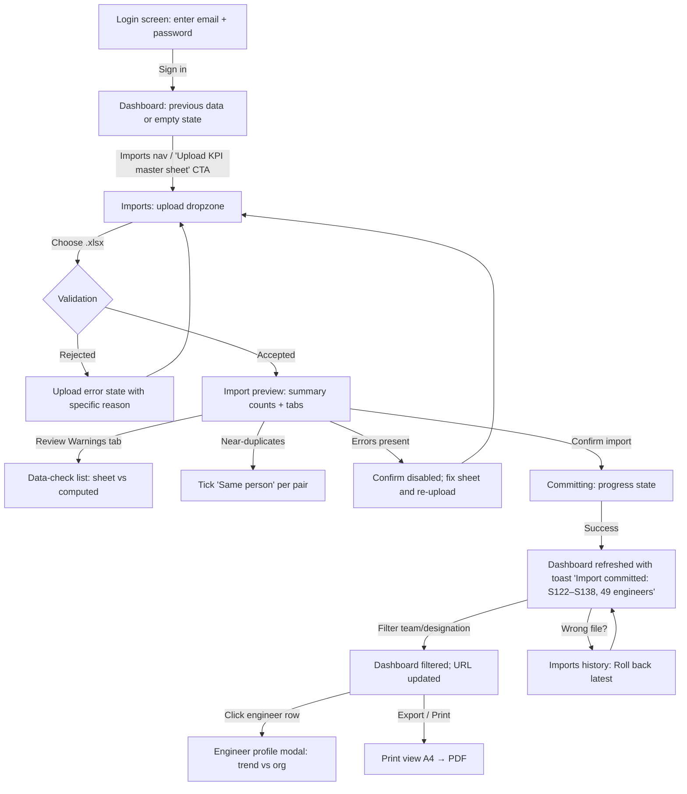
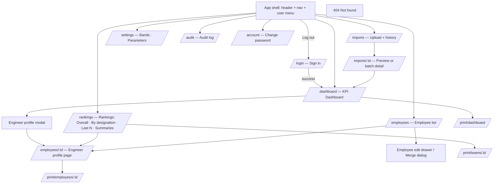

# UX/UI Design Specification — hrm (Cloudtech HRM & Engineering KPI Dashboard)

**Version:** 1.0 · **Date:** 2026-10-15 · **Inputs:** [requirements](../requirements/requirements.md) · [architecture](../architecture/architecture.md) · [backlog](../backlog/backlog.md) · reference report `Cloudtech_KPI_Dashboard_S122-S135.html`

**Interview answers (from requirements and the user's direction):**
1. **Users:** the HR Admin is the only user. Management consumes PDFs and exports.
2. **Platform:** responsive web, 360–1920 px, desktop-first.
3. **Brand:** the reference report's palette and type stack.
4. **Tone:** utilitarian and data-dense, in the familiar "Cloudtech report" look.
5. **Accessibility:** WCAG 2.1 AA, plus the Nepal Individual Privacy Act 2075 on how data is shown.
6. **Highest-stakes flows:** import (upload → preview → commit) and dashboard reading.

---

## UX Strategy & Design Principles

1. **Trust the numbers, show the evidence.** Every figure can be traced: tooltips show the counts behind averages, the data-check banner surfaces sheet errors, and 3-dp tooltips explain rank order where averages display as tied. *(BO-2 100% accuracy, US-02-04, ADR-016)*
2. **Nothing changes without a preview.** Imports are always two steps, upload then review then confirm, with counts before any write, and the latest import can be undone. *(US-02-03, US-02-06)*
3. **Familiar first.** The dashboard keeps the reference report's layout, colours and vocabulary (Outstanding / Exceeds / Meets / Needs Improvement), so Management needs no retraining. *(NFR-26, BO-3)*
4. **Dense but calm.** Show many numbers with tabular figures, 2 dp, zebra rows and one accent colour per meaning; never more than one primary action per view. *(NFR-31, NFR-02)*
5. **Never colour alone.** Every band, delta and status pairs colour with text or an icon, and charts have table alternatives. *(NFR-24)*
6. **Print is a first-class view.** Every report screen has an A4 print layout with the filters, range and a confidentiality footer. *(US-07-01)*

---

## Personas & Primary User Journeys

**Persona 1 — Priya, HR Admin (primary, the only signed-in user)**
- *Goals:* publish the sprint KPI report in under 10 minutes; prepare appraisal packs; keep employee records clean.
- *Context:* an office laptop (1366–1920 px), occasionally a tablet; the master sheet arrives from Team Leads every 2 weeks.
- *Pain points:* hand-maintained formulas, inconsistent names, wrong averages discovered too late, re-building the HTML report by hand.

**Persona 2 — Management reader (indirect: PDFs and screen-share)**
- *Goals:* org health at a glance, who is improving or declining, fair rankings for appraisals.
- *Context:* meeting rooms, projected or printed A4, sometimes grayscale.
- *Pain points:* doesn't trust numbers whose source is unclear; finds dense spreadsheets hard to read.

### Primary journey — publish a sprint report


### Secondary journeys
- **Appraisal pack:** Rankings → By designation tab → engineer → profile page → Print appraisal (A4).
- **Fix identity:** a near-duplicate warning → Employees → Edit (rename keeps the alias) or Merge.
- **Policy change:** Settings → Bands → preview "N engineers change band" → Save.

---

## Information Architecture & Navigation Map

Global navigation is a single top bar (desktop) that collapses to a menu button below 768 px. There are no nested menus; secondary navigation is tabs inside a page.



| Screen | Route | Story |
|---|---|---|
| Sign in | `/login` | E-01-01 |
| KPI Dashboard | `/dashboard` | E-05-01…06 |
| Engineer profile modal / page | modal, `/employees/[id]` | E-06-01/02 |
| Rankings (tabs) | `/rankings?tab=` | E-06-03/04/05 |
| Imports (upload + history) | `/imports` | E-02-01/05/09 |
| Import preview / detail | `/imports/[id]` | E-02-05/06/07/08 |
| Employees list + edit + merge | `/employees` | E-03-01…06 |
| Settings | `/settings?tab=` | E-08-01…05 |
| Audit log | `/audit` | E-09-02 |
| Account | `/account` | E-01-05 |
| Print views | `/print/*` | E-07-01/04/05 |

---

## Key Screens & Wireframes

### 1. Sign in (`/login`)
```
┌───────────────────────────────────────┐
│▀▀▀▀▀▀▀▀▀▀▀▀▀▀▀▀▀▀▀▀▀▀▀▀▀▀▀▀▀▀▀▀▀▀▀▀▀▀▀│  teal 4px top border
│ Cloudtech HRM                         │  navy band
│ Sign in to the KPI dashboard          │
├───────────────────────────────────────┤
│ EMAIL                                 │
│ [______________________________]      │
│ PASSWORD                              │
│ [______________________________]      │
│ ⚠ Invalid email or password           │  alert (role=alert)
│ [          Sign in            ]       │  primary
└───────────────────────────────────────┘
```
- **Purpose:** authenticate the HR Admin.
- **Components:** Card, TextField ×2, Alert, Button(primary).
- **Data:** none.
- **Primary action:** Sign in. **Secondary:** none (password reset is out of scope).

### 2. App shell
```
┌──────────────────────────────────────────────────────────────────────────────┐
│ Cloudtech HRM            Dashboard Rankings Imports Employees Settings Audit │
│ Engineering KPI Dashboard                         hr@cloudtech…  [Log out]   │
├──────────────────────────────────────────────────────────────────────────────┤
│                          (page content, max-width 1180px)                    │
├──────────────────────────────────────────────────────────────────────────────┤
│ Cloudtech Services · Confidential                                            │
└──────────────────────────────────────────────────────────────────────────────┘
```
Skip link, then header, then main, then footer. The active nav item is bold + underlined with `aria-current="page"`.

### 3. KPI Dashboard (`/dashboard`) — parity with the reference report
```
┌──────────────────────────────────────────────────────────────────────────────┐
│ KPI Dashboard                                      [⇩ Export ▾] [🖶 Print]   │
│ Sprint S122–S138 (17) · 49 engineers · Last import 13 Nov 2026 14:05 · Bands │
├──────────────────────────────────────────────────────────────────────────────┤
│ ⚠ Data check: 2 rows in the latest import differ from the sheet … [Details] ✕│
├─FILTERS──────────────────────────────────────────────────────────────────────┤
│ DESIGNATION ▾  TEAM ▾  RATING ▾  COVERAGE ▾  SPRINTS [S122▾]–[S138▾]          │
│ SEARCH NAME [____________]   ☐ Include inactive           [Reset]            │
├─CARDS (auto-fit, min 150px)──────────────────────────────────────────────────┤
│ ENGINEERS │ ORG AVG │ S138 AVG   │ COVERAGE │ OUTSTANDING │ EXCEEDS+ │ MEETS │ NI │
│   49      │  7.78   │ 8.41       │  95.9%   │ 20 (41%)    │ 49 (100%)│ 0 (0%)│0(0%)│
│ in view   │ /10 all │ 47 scored  │ S138     │ ≥ 8.00      │ ≥ 6.00   │5–5.99 │<5  │
├─────────────────────────────────────────┬────────────────────────────────────┤
│ Average score by designation  [table ⇄] │ Rating distribution     [table ⇄]  │
│ ▇▇▇▇▇ TL 8.04 ▇▇▇▇ SSE ▇▇▇▇ SE ▇▇▇ ASE  │   ◔ doughnut + legend with counts  │
├─────────────────────────────────────────┼────────────────────────────────────┤
│ Average score by team (horizontal bars) │ Org average per sprint (line)      │
├─────────────────────────────────────────┴────────────────────────────────────┤
│ Momentum — biggest movers (last 3 vs prior 3, 6+ sprints) — diverging bars  │
├──────────────────────────────────────────────────────────────────────────────┤
│ Engineers (49 shown)                                                         │
│ RANK│NAME          │TEAM      │DESIG│SPRINTS│TOTAL │AVG │LAST 3│MOMENTUM│RATING│
│  1  │Dilendra T.   │AI Team   │ASE  │   1   │10.00 │10.0│10.00 │   —    │[Out] │
│  …  │ (zebra rows; row is a button → profile modal)                          │
└──────────────────────────────────────────────────────────────────────────────┘
```
- **Purpose:** org health at a glance, plus a drill-down.
- **Layout regions:** header line, banner, filters, cards, a 2-column chart grid (1.3fr / 1fr, then 1fr / 1fr), full-width momentum chart, full-width table.
- **Components:** PageHeader, DataCheckBanner, FilterBar (Select ×5, SprintRangeSelect, SearchField, Checkbox, Button), StatCard ×8, ChartPanel ×5 (with a TableToggle), DataTable (sortable), BandPill, DeltaText.
- **Primary action:** filter and explore. **Secondary:** Export, Print.
- **Data:** the `KpiDatasetDto`, computed client-side (ADR-009).

### 4. Engineer profile — modal (from table) and page (`/employees/[id]`)
```
┌───────────────────────────────────────────────────────── [✕] ┐
│ Shishir Sharma                                               │
│ ASE · Team Bravo · Overall rank 18 of 49 · ASE rank 8 of 20  │
├──────────┬──────────┬──────────┬──────────────┬──────────────┤
│ AVG 8.15 │ TOTAL    │ SPRINTS  │ RATING       │ RUN SPRINTS  │
│          │ 138.56   │ 17       │ [Outstanding]│ 0            │
│ LAST 3   │ MOMENTUM │ BEST/WRST│ VARIABILITY  │              │
│ 8.42     │ ▲ +0.38  │10.00/4.64│ ±1.67        │              │
├──────────┴──────────┴──────────┴──────────────┴──────────────┤
│  line: engineer (solid teal, gaps = RUN/N/A) vs org (dashed) │
├──────────────────────────────────────────────────────────────┤
│ [Open full profile]   [Print appraisal]                      │
└──────────────────────────────────────────────────────────────┘
```
The page version adds a **score table** (Sprint | Score or RUN/N/A | Source import | ✎ Correct) and breadcrumbs (Employees › Name).

### 5. Rankings (`/rankings`)
```
[ Overall ] [ By designation ] [ Last 6 sprints (S133–S138) ] [ Summaries ]
┌ RANK │ NAME │ DESIGNATION │ TEAM │ SPRINTS │ AVG │ TOTAL ┐  (per tab)
...
Not yet eligible (fewer than N sprints): name list with sprint counts
```
- **By designation:** one table per designation (Team Lead, SSE, SE, ASE).
- **Summaries:** a team table, a designation table, the Top-10 list, a headline row and an interpretation paragraph.

### 6. Imports (`/imports`) — upload and history
```
┌ Upload KPI master sheet ─────────────────────────────────────────────┐
│  ┌──────────────────────────────────────────────────────────────┐   │
│  │  ⇪  Drag the .xlsx here or [Choose file]                     │   │
│  │     .xlsx or .csv · max 5 MB · "Compile Sheet" layout        │   │
│  └──────────────────────────────────────────────────────────────┘   │
└──────────────────────────────────────────────────────────────────────┘
History
│ DATE          │ FILE                    │ STATUS     │ BY   │ CHANGES │      │
│ 13 Nov 14:05  │ KPI Master Sheet (2).xlsx│ Committed │ hr@  │ +560    │[Roll back]│
│ 30 Oct 10:12  │ KPI Master Sheet.xlsx    │ Rolled back│ hr@ │ …       │[⇩ Original]│
```

### 7. Import preview (`/imports/[id]`)
```
┌──────────────────────────────────────────────────────────────────────────────┐
│ Review import · KPI Master Sheet (2).xlsx · sheet "Compile Sheet " row 1      │
│ Sprints S122–S138 (S139–S141 empty, ignored) · expires in 28 min             │
├─SUMMARY──────────────────────────────────────────────────────────────────────┤
│ 49 rows │ 49 new employees │ 0 changed │ 17 new sprints │ 560 scores added │  │
│ 0 changed │ 0 unchanged │ 0 not in file │ ⛔ 0 errors │ ⚠ 1 warning          │
├──────────────────────────────────────────────────────────────────────────────┤
│ [New employees 49] [Changes 0] [Scores 560] [Warnings 1] [Errors 0]          │
│ … table for the selected tab …                                              │
│ Near-duplicates: "Niva Awale" ↔ existing "Niva  Awale" ☐ Same person         │
├──────────────────────────────────────────────────────────────────────────────┤
│                                      [Discard]   [Confirm import]            │
└──────────────────────────────────────────────────────────────────────────────┘
```
- **Purpose:** an informed, atomic commit.
- **Primary action:** Confirm import, disabled when there are errors. **Secondary:** Discard.

### 8. Employees (`/employees`)
A list table (Name, Code, Team, Designation, Status, Sprints scored, ✎). Edit opens a **drawer** with fields, lock indicators (🔒 *Team locked — imports won't change it* [Unlock]) and aliases as chips. **Merge** opens a dialog: pick the source, choose a conflict policy, then confirm by typing the target name. **Erase** is a danger-zone section inside the drawer, confirmed by typing the name.

### 9. Settings (`/settings`)
- **Bands tab:** four rows (label, minimum), each with an inline error, and a live preview "3 engineers change band".
- **Parameters tab:** grouped fields with help text and defaults.
- **Footer:** [Reset to defaults] [Save].

### 10. Audit log (`/audit`)
Filters (date range, action); a table (Time NPT, Actor, Action, Entity); a row expands into a before/after diff; "Load more" cursor pagination.

### 11. Print layouts (`/print/*`)
- **Page:** A4. A header block on every page shows the title, filters applied, sprint range and generated time (NPT).
- **Content:** a single column; panels use `break-inside: avoid`.
- **Footer:** "Cloudtech Services · Confidential · page X".
- **Hidden:** navigation, filters and buttons.

---

## Interaction & State Design

| Screen / component | Default | Empty | Loading | Error | Success | Disabled |
|---|---|---|---|---|---|---|
| Login form | fields blank, focus on Email | — | button "Signing in…" + spinner, inputs read-only | `role=alert`: "Invalid email or password" / lockout: "Too many failed attempts. Try again in 15 minute(s)." | redirect to `next` or `/dashboard` | button disabled while pending |
| Dashboard | last committed data | "No KPI data yet" card + **Upload KPI master sheet** CTA | skeleton cards (8) + chart placeholders on range change only | panel-level "Couldn't load KPI data. [Retry]" | — | Reset disabled when filters are default |
| Filter bar | all "All …" | — | — | invalid range (from > to) is prevented: the `to` options before `from` are disabled | URL updated (no toast) | — |
| Chart panel | chart | "No engineers match these filters." / momentum: "No engineer in this view has 6+ scored sprints to compare." | grey shimmer box, same height | "Chart unavailable — see the table view" | — | — |
| Data table | sorted by rank asc | "No engineers match these filters. [Reset filters]" | 5 skeleton rows | — | — | — |
| Upload dropzone | idle | — | progress bar "Uploading… / Validating…" | inline reason from the API (e.g. "Macro-enabled workbooks (.xlsm) are not accepted — save as a plain .xlsx.") + [Choose another file] | navigates to the preview | dropzone disabled during upload |
| Import preview | summary + first tab with content | each tab: "Nothing in this category." | — | stale (409): banner "Data changed since this preview. [Upload again]"; expired (410): same with "expired" | toast "Import committed — 560 scores, 49 engineers" → dashboard | Confirm disabled with tooltip "Fix the 3 errors in the sheet first" |
| Roll back | button on the latest committed batch only | — | dialog button "Rolling back…" | 409: "Later changes exist (an edit or merge since this import) — roll back is no longer possible." | toast "Import rolled back" | hidden or disabled with a reason on other rows |
| Employee drawer | values | aliases: "No other spellings" | Save "Saving…" | field errors inline; 409: "Employee code already used by …" | toast "Saved" + lock chip appears | Save disabled until dirty |
| Settings | values | — | Save "Saving…" | inline: "Minimums must strictly descend" | toast "Settings saved — dashboard recalculated" | Save disabled until valid and dirty |
| Audit | newest 50 | "No events for these filters." | skeleton rows | retry banner | — | "Load more" hidden at end |

**Validation copy (inline, below field, `aria-describedby`):**
- **Email:** "Enter an email address."
- **New password:** "Use at least 12 characters." / "The new password must differ from the current one."
- **Band minimum:** "Enter a number from 0 to 10." / "Must be lower than the band above."
- **Score correction:** "Enter a score from 0.00 to 10.00, RUN or N/A." / "Give a reason (3–500 characters)."
- **Merge/erase confirm:** "Type the employee's name exactly to confirm."

**Async feedback:**
- Toasts (`role=status`, polite) auto-dismiss after 5 s and pause on hover or focus.
- Long operations (commit, rollback, backup) show an inline button spinner plus disabled controls; there are no full-page blockers.

**Micro-interactions:**
- Sortable column headers show ▲/▼ and toggle on click or Enter.
- Rows get a hover tint (`--zebra-hover`).
- Momentum delta: ▲ green / ▼ red / – grey, always with a sign and value.
- The profile modal fades in over 150 ms (none under reduced motion).

**Destructive actions (always confirm):**

| Action | Confirmation |
|---|---|
| Roll back | dialog listing what reverts; [Cancel] [Roll back] (danger) |
| Discard preview | inline confirm |
| Merge | dialog, then type the target name |
| Erase employee | type the exact name; the dialog states "This also deletes N stored upload files and blocks rollback of earlier imports" |
| Reset settings | dialog |
| Log out | no confirmation (non-destructive) |

---

## Design System Foundations

### Design tokens

**Colour roles.** The brand comes from the reference report. Text-safe variants were added where the brand hue fails AA.

| Token | Light | Dark | Usage |
|---|---|---|---|
| `--color-navy` | #10233F | #0B1A2F | header, headings, table headers |
| `--color-teal` | #0F6E78 | #2BA7B3 | primary buttons, accents, links (5.96:1 on white) |
| `--color-teal-strong` | #0B5961 | #4FC1CC | primary hover / pressed (replaces #13909C for text-bearing states) |
| `--color-teal2` | #13909C | #13909C | chart fill only (3.82:1 is OK for graphics, not text) |
| `--color-page` | #F0F3F6 | #0F1722 | page background |
| `--color-surface` | #FFFFFF | #16212F | cards, panels |
| `--color-ink` | #1F2933 | #E6EDF3 | body text |
| `--color-muted` | #5A6470 | #9AA8B6 | secondary text (6.01:1) |
| `--color-line` | #D5DEE5 | #2A3A4D | borders |
| `--color-zebra` | #F6F9FB | #1A2737 | even rows |
| `--color-band-out` | #17733F | #4CC38A | Outstanding pill bg + text-safe green (5.90:1 with white) |
| `--color-band-exc` | #0F6E78 | #2BA7B3 | Exceeds |
| `--color-band-meet` | #8A5A00 | #E0A33A | Meets (amber darkened: 5.93:1; brand #C8881A is graphics-only) |
| `--color-band-ni` | #C0392B | #F07466 | Needs Improvement (5.44:1) |
| `--color-chart-out/exc/meet/ni` | #1E8E4E / #0F6E78 / #C8881A / #C0392B | same | chart marks (≥3:1 vs surface) |
| `--color-focus` | #13909C | #4FC1CC | 2 px focus ring, 2 px offset |
| `--color-warning-bg` / `-border` / `-text` | #FFF8E7 / #EBD9A8 / #6B5316 | #2E2614 / #6B5316 / #F3D58C | data-check banner |

**Type scale.** The system UI stack is `-apple-system, Segoe UI, Roboto, Helvetica, Arial`. Base size 14 px, line-height 1.45.

| Token | Size / weight | Usage |
|---|---|---|
| `--text-xs` | 11px / 700, uppercase, +0.04em | labels, table headers, card keys |
| `--text-sm` | 13px / 400 | tables, controls |
| `--text-base` | 14px / 400 | body |
| `--text-lg` | 18px / 700 | page and app title |
| `--text-xl` | 20px / 700 | modal title |
| `--text-stat` | 26px / 800, tabular-nums | stat card value |

**Spacing** uses a 4 px base: 4, 8, 12, 14, 16, 18, 20, 24, 32. The page gutter is 16 px on mobile and 20–24 px on desktop; the content max-width is 1180 px.

**Radii:** `--radius-sm` 6 px (inputs, buttons), `--radius-md` 10 px (cards, panels), `--radius-lg` 12 px (modal), `--radius-pill` 20 px.

**Elevation:** `--shadow-0` none (panels rely on borders); `--shadow-1` 0 1px 2px rgba(16,35,63,.08) (cards on hover); `--shadow-modal` 0 12px 32px rgba(16,35,63,.25); the scrim is rgba(16,35,63,.55).

**Motion:** `--duration-fast` 120 ms, `--duration-base` 150 ms; easing `cubic-bezier(.2,.8,.2,1)`. Everything drops to 0 ms under `prefers-reduced-motion`.

### Component inventory

| Component | Variants | Sizes | States |
|---|---|---|---|
| Button | primary (teal), secondary (outline), ghost (on navy), danger (red) | sm 32 px, md 40 px | default, hover, focus, active, disabled, loading |
| TextField / NumberField | default, with prefix/suffix | md | default, focus, error, disabled, read-only |
| Select | single | md | as above + open |
| SprintRangeSelect | from–to pair | md | invalid options disabled |
| SearchField | with clear ✕ | md | — |
| Checkbox / Toggle | — | — | checked, unchecked, indeterminate, disabled |
| Tabs | underline | — | selected, focus (roving tabindex) |
| StatCard | accent: neutral/out/exc/meet/ni | — | default, skeleton |
| BandPill | out/exc/meet/ni/na | sm | — |
| DeltaText | up/down/flat/none | — | — |
| ChartPanel | bar-v, bar-h, doughnut, line, diverging | heights 240/300/340 px | default, empty, loading, error, table view |
| DataTable | sortable, selectable-row, expandable-row | dense 32 px rows / comfortable 40 px | sorted asc/desc, row hover/focus, empty, loading |
| DataCheckBanner | warning | — | collapsed, expanded, dismissed |
| Alert | error, warning, info, success | — | — |
| Toast | success, error, info | — | auto-dismiss / persistent |
| Modal / Dialog | info, confirm, danger-confirm (typed) | md 680 px, sm 440 px | open, closing |
| Drawer | right | 480 px / full on mobile | open |
| Dropzone | — | — | idle, drag-over, uploading, error |
| Skeleton | line, box, row | — | — |
| Breadcrumbs, PageHeader, EmptyState, Pagination ("Load more") | — | — | — |

### Theming
Tokens are CSS custom properties on `:root`. Dark mode is applied under `@media (prefers-color-scheme: dark)` unless `:root[data-theme="light"]`, and is forced by `:root[data-theme="dark"]`. Tailwind v4 `@theme` maps utilities to these variables, so components never hard-code hex values. **Print always uses the light theme.** v1 ships light by default; the dark token values are defined and verified for contrast, and a theme toggle is a later addition.

---

## Accessibility Specification (WCAG 2.1 AA)

- **Contrast (flagged brand colours):**
  - `#C8881A` amber is **3.00:1** on white, which fails for text. Use it for chart marks only; band text and pills use `#8A5A00`.
  - `#1E8E4E` green is **4.17:1**, which fails for small text. Pills use `#17733F` (5.90:1); charts may keep `#1E8E4E`.
  - `#13909C` teal2 is **3.82:1**: graphics and the focus ring only, never a text or button background with white text. **The current code uses `hover:bg-teal2` with white text, so change it to `--color-teal-strong`** (dev follow-up).
  - `#A9BFC8` header subtext on navy is **8.22:1** ✓. Muted `#5A6470` on white is **6.01:1** ✓, and on the page background 5.40:1 ✓.
- **Keyboard:** every action is reachable by Tab in visual order (skip link → nav → user menu → page header actions → filters → cards (not focusable) → chart table toggles → table header sort buttons → rows). Rows are focusable and Enter opens the profile. Tabs use arrow keys with roving tabindex. Modals and drawers trap focus, Esc closes them, and focus returns to the trigger.
- **Visible focus:** 2 px `--color-focus` outline, 2 px offset, never removed.
- **Semantics:**
  - **Tables:** native `<table>` with `scope=col`; sortable headers are `<button>` elements with `aria-sort` on the `<th>`.
  - **Charts:** `<canvas role="img" aria-label>`, `aria-describedby` → a summary sentence, plus a "Show as table" toggle rendering a real table.
  - **Overlays:** the modal is `role=dialog aria-modal=true aria-labelledby`; toasts are `role=status`; the banner is `role=region aria-label="Data check"`.
- **Forms:** every input has a visible `<label>`. Errors are linked with `aria-describedby` and `aria-invalid=true`. On submit with errors, focus moves to the first invalid field, and an error summary is shown for multi-field forms (Settings).
- **No colour-only meaning:** band pills always carry the label text; momentum shows ▲/▼ plus a signed value; chart legends include the names; the active nav item is bold + underlined.
- **Reduced motion:** all transitions are disabled and chart animations are off.
- **Target size:** a minimum of 24×24 px (2.5.8), with 40 px targets for primary controls on touch widths.
- **Language:** `lang="en"`. Names render as typed (Unicode / Devanagari OK).

---

## Responsive & Breakpoint Behavior

**Desktop-first.** The primary context is HR on a laptop, and the dashboard is data-dense. Everything still works at 360 px with no horizontal page scroll; wide tables scroll inside their own container.

| Breakpoint | Width | Changes |
|---|---|---|
| `xl` | ≥ 1280 | content max-width 1180 px, centred |
| `lg` | 1024–1279 | same layout; the user email is hidden in the header (button only) |
| `md` | 768–1023 | chart grid → 1 column; filters wrap into 2–3 per row; profile mini-stats 4 → 3 per row |
| `sm` | < 768 | nav collapses to a Menu button; cards 2 per row; filters stack full-width; tables scroll horizontally inside their panel (with a sticky name column); the modal becomes full-screen; the drawer is full-width; preview tabs become a horizontal scroll strip |
| `xs` | 360 | gutter 16 px; stat value 22 px; action buttons full-width |

**Print:** A4 portrait for profiles, landscape suggested for the dashboard. Fixed widths, no interactive controls, and charts render at 2× DPR.

---

## Handoff Notes for Architecture & Development

| Design element | Implementation unit (TypeScript) |
|---|---|
| Tokens | `src/app/globals.css` (`@theme` + CSS variables, dark-mode block) |
| Button, TextField, Select, Checkbox, Tabs, Modal, Drawer, Toast, Alert, Skeleton, EmptyState | `src/components/ui/*` (client components where interactive) |
| StatCard, BandPill, DeltaText, DataCheckBanner, FilterBar, SprintRangeSelect | `src/components/dashboard/*` |
| ChartPanel + charts | `src/components/charts/*` (Chart.js, client-only, table toggle) |
| DataTable (sortable, keyboard rows) | `src/components/ui/data-table.tsx` (generic over row type) |
| EngineerProfile (modal + page body shared) | `src/components/employees/engineer-profile.tsx` |
| ImportWizard (dropzone, preview tabs, confirm) | `src/components/import/*` |
| Print layouts | `src/app/print/**` + `src/components/print/*` |

**Decisions with architectural weight:**
1. **Dashboard filtering is client-side** over the compact dataset (ADR-009). The filter state lives in the URL (`useSearchParams` + `router.replace`).
2. **Upload** uses multipart with server-side limits (ADR-008). There is no real progress for the parse step: show indeterminate "Validating…" after the upload completes.
3. **The preview expires after 30 minutes:** show a countdown and handle 409/410 states (ADR-007).
4. **Dark-mode tokens** are defined, but the v1 default is light. Charts must read their colours from CSS variables at render time.
5. **Time display:** Asia/Kathmandu (UTC+05:45) via `Intl.DateTimeFormat`, format `DD MMM YYYY HH:mm`.
6. **i18n:** English only; strings centralised. RTL is not required.

**Dev follow-ups from this spec:**
- (a) Replace the `hover:bg-teal2` (white text) and band text colours in the current shell and login with the text-safe tokens.
- (b) Add the `--color-surface/page` tokens and the dark block to `globals.css`.

**Open questions:**
- **DQ-01:** Should the dashboard table default to the overall rank or the designation rank when `rankingScope = designation`? (Ties to OQ-04.) *Owner: Management.*
- **DQ-02:** Do Management PDFs need a company logo? No logo asset was provided, so v1 uses a text wordmark. *Owner: HR.*
- **DQ-03:** Should a dark-mode toggle ship in v1, or follow the OS setting only? Proposed: follow the OS only, after v1. *Owner: HR.*
